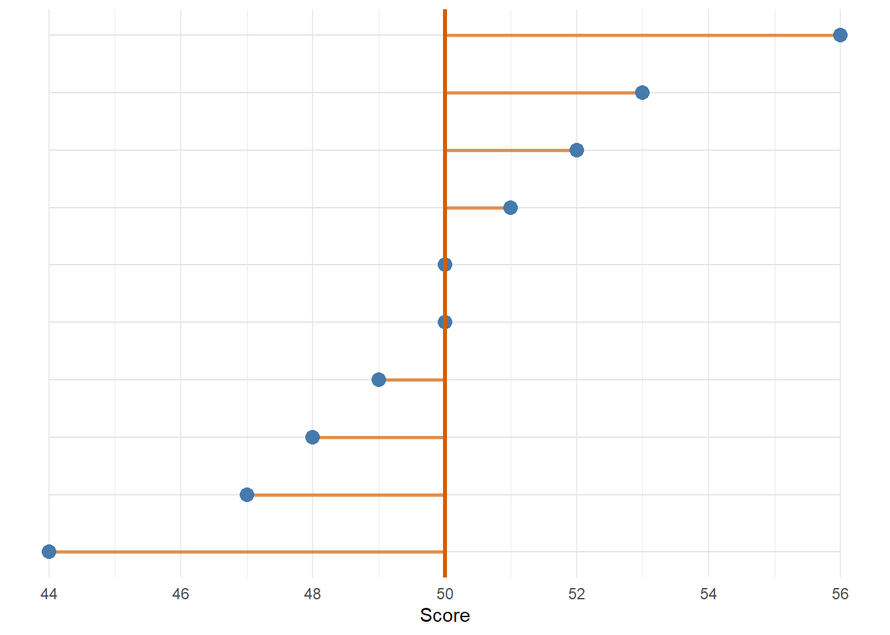

# Turning Equations Into R

## Equations Are Recipes

A statistical equation can look intimidating because it compresses a lot of instructions into a small space. R code can help us unfold those instructions.

This chapter focuses on the mean and variance. The mean tells us where the centre of a set of values is. Variance tells us how spread out the values are around that centre.

The path is:

```text
values -> mean -> distances from the mean -> variance -> standard deviation
```

This is the first bit of the wider tree. We start with raw values, then build the summaries that later become standard error and the t-statistic.

## Seeing The Mean

Let us start with a small set of values.


``` r
x <- c(44, 47, 48, 49, 50, 50, 51, 52, 53, 56)
mean_x <- mean(x)

scores <- tibble(value = x)
scores
```

<div class="kable-table">

| value|
|-----:|
|    44|
|    47|
|    48|
|    49|
|    50|
|    50|
|    51|
|    52|
|    53|
|    56|

</div>

``` r
mean_x
#> [1] 50
```

The mean is the balance point of the values. In the graph below, each dot is one value on the x-axis and the orange line is the mean.


``` r
mean_data <- tibble(
  value = x,
  y = 1:length(x)
)

ggplot(mean_data, aes(x = value, y = y)) +
  geom_segment(
    aes(x = min(x), xend = max(x), y = y, yend = y),
    colour = "grey90"
  ) +
  geom_point(size = 4, colour = "#467AAC") +
  geom_vline(xintercept = mean_x, linewidth = 1.2, colour = "#D55E00") +
  scale_x_continuous(breaks = seq(44, 56, 2)) +
  scale_y_continuous(NULL, breaks = NULL) +
  labs(x = "Score") +
  theme_minimal()
```

<div class="figure">

<p class="caption">(\#fig:mean-visual)The mean as the centre of a small set of values.</p>
</div>

The orange line is not one of the raw values. It is a summary of all the values.

What is the mean of `c(44, 47, 48, 49, 50, 50, 51, 52, 53, 56)`? <input class='webex-solveme nospaces' size='2' data-answer='["50"]'/>

## Seeing Distances From The Mean

Variance starts by asking how far each value is from the mean.


``` r
distance_data <- tibble(
  value = x,
  mean = mean_x,
  y = 1:length(x)
)

ggplot(distance_data) +
  geom_segment(
    aes(x = min(x), xend = max(x), y = y, yend = y),
    colour = "grey90"
  ) +
  geom_segment(
    aes(x = mean, xend = value, y = y, yend = y),
    colour = "#D55E00",
    linewidth = 1,
    alpha = .65
  ) +
  geom_point(aes(x = value, y = y), size = 3.5, colour = "#467AAC") +
  geom_vline(xintercept = mean_x, linewidth = 1.1, colour = "#D55E00") +
  scale_x_continuous(breaks = seq(44, 56, 2)) +
  scale_y_continuous(NULL, breaks = NULL) +
  labs(x = "Score") +
  theme_minimal()
```

<div class="figure">

<p class="caption">(\#fig:distance-visual)Each value has a distance from the mean.</p>
</div>

The orange line segments are the distances from each value to the mean. Some values are close to the mean and some are further away. Variance is a way of turning all those distances into one number.

## From Points To A Distribution

The same values can also be shown as a small distribution.


``` r
ggplot(scores, aes(x = value)) +
  geom_histogram(
    binwidth = 2,
    boundary = 43,
    colour = "white",
    fill = "#467AAC"
  ) +
  geom_vline(xintercept = mean_x, linewidth = 1.2, colour = "#D55E00") +
  scale_x_continuous(breaks = seq(44, 56, 2)) +
  labs(x = "Score", y = "Count") +
  theme_minimal()
```

<div class="figure">

<p class="caption">(\#fig:value-distribution)The same values shown as a small distribution.</p>
</div>

This is the same x-axis as the dot plot. The values have not changed. The display has changed.

That matters because we can now move between:

```text
individual points -> distribution of values -> summaries of that distribution
```

## Seeing Variance

Here are three distributions with the same mean but different standard deviations.


``` r
dist_x <- seq(-4, 4, 0.01)

dist_data <- tibble(
  value = c(dist_x, dist_x, dist_x),
  density = c(
    dnorm(dist_x, mean = 0, sd = 0.6),
    dnorm(dist_x, mean = 0, sd = 1.0),
    dnorm(dist_x, mean = 0, sd = 1.6)
  ),
  spread = c(
    rep("Small spread", length(dist_x)),
    rep("Medium spread", length(dist_x)),
    rep("Large spread", length(dist_x))
  )
)

ggplot(dist_data, aes(x = value, y = density, colour = spread)) +
  geom_line(linewidth = 1.1) +
  geom_vline(xintercept = 0, linetype = "dashed") +
  scale_colour_manual(values = c(
    "Small spread" = "#467AAC",
    "Medium spread" = "#D55E00",
    "Large spread" = "#7B4AB8"
  )) +
  labs(x = "Value", y = "Density", colour = NULL) +
  theme_minimal()
```

<div class="figure">

<p class="caption">(\#fig:variance-visual)Same mean, different spread.</p>
</div>

All three curves are centred in the same place. The difference is how far the values tend to sit from that centre. This is the visual idea behind variance.

## Try It Interactively

Use the widget below to change the mean and variance of a normal distribution.

<iframe src="apps/mean-variance/embed.html" width="100%" height="720" title="Mean and variance interactive widget" style="border: 0;"></iframe>

The point of the widget is simple: move the mean and the whole distribution shifts left or right. Increase the variance and the distribution spreads out. Decrease the variance and it gets tighter. You can also switch the dots, distance lines, and bell curve on and off to focus on one part at a time.

## The Variance Equation

Now we can connect the picture to the equation:

$$
s^2 = \frac{\sum_{i=1}^{n}(x_i - \bar{x})^2}{n-1}
$$

The formula says:

1. take each value in `x`;
2. subtract the mean of `x`;
3. square that distance;
4. add all the squared distances together;
5. divide by `n - 1`.

That is not magic. It is repeated subtraction, squaring, addition, and division.

## Notation To R

Here are the main symbols we need:

| Math | Meaning | R |
|---|---|---|
| $x$ | a vector of values | `x` |
| $n$ | number of values | `length(x)` |
| $\bar{x}$ | mean of `x` | `mean(x)` |
| $(x_i - \bar{x})^2$ | squared distance from the mean | `(i - mean_x)^2` |
| $\sum$ | add repeated values | `sum()` |

The symbol $\sum$ is often the bit that looks most alarming. For our purposes, read it as:

<div class="summary-box">
Do this same calculation for every value, then add the results with `sum()`.
</div>

## Repeated Addition

Before variance, let us practice adding repeated values.


``` r
x <- c(1, 2, 3, 4, 5)

x
#> [1] 1 2 3 4 5
sum(x)
#> [1] 15
```

The function `sum()` adds all the values in `x`.

The sum of `c(1, 2, 3, 4, 5)` is <input class='webex-solveme nospaces' size='2' data-answer='["15"]'/>.

## A Mean Function

The mean has two steps:

1. Add the values.
2. Divide by the number of values.

That is small enough for us to write ourselves.


``` r
my_mean <- function(x) {
  total <- sum(x)
  n <- length(x)
  mean_value <- total / n
  return(mean_value)
}

my_mean(score_values)
#> [1] 51
mean(score_values)
#> [1] 51
```

The function `my_mean()` should give the same answer as `mean()`. The useful bit is that we can now see the pieces inside it.

Which line counts how many values are in `x`? <select class='webex-select'><option value='blank'></option><option value=''>total <- sum(x)</option><option value='answer'>n <- length(x)</option><option value=''>return(mean_value)</option></select>

## Squared Distances

Variance is based on distances from the mean.


``` r
x <- score_values
mean_x <- my_mean(x)

x
#> [1] 48 51 49 54 52 50 53 51
mean_x
#> [1] 51
x - mean_x
#> [1] -3  0 -2  3  1 -1  2  0
(x - mean_x)^2
#> [1] 9 0 4 9 1 1 4 0
```

The values `x - mean_x` are distances from the mean. We square them so negative and positive distances do not cancel each other out.

The total squared distance is:


``` r
sum((x - mean_x)^2)
#> [1] 28
```

That value is the numerator of the variance equation. The rest of the equation turns it into an average squared distance.

## Variance By Hand

Now we can build the formula.


``` r
my_var <- function(x) {
  n <- length(x)
  mean_x <- my_mean(x)
  squared_distances <- (x - mean_x)^2
  total_squared_distance <- sum(squared_distances)

  variance <- total_squared_distance / (n - 1)
  return(variance)
}

my_var(score_values)
#> [1] 4
var(score_values)
#> [1] 4
```

The function `my_var()` should match `var()`.

What does `length(x)` give us in this formula? <select class='webex-select'><option value='blank'></option><option value='answer'>the number of values</option><option value=''>the largest value</option><option value=''>the mean</option></select>

## Why Divide By `n - 1`?

For sample variance, we divide by `n - 1` rather than `n`. The short version is that we are using the sample mean as an estimate of the population mean, and that costs us one degree of freedom.

You do not need the full proof here. The teaching point is simpler: this is part of the process in the recipe, so our function needs to do it.

Try changing the final line to divide by `n` instead. Does it still match `var()`?


<div class='webex-solution'><button>Expected result</button>

No. R's `var()` calculates sample variance, so it divides by `n - 1`.

</div>


## Standard Deviation

Standard deviation is the square root of variance.


``` r
sqrt(my_var(score_values))
#> [1] 2
sd(score_values)
#> [1] 2
```

So if we understand variance, standard deviation is just one more operation.

The square root operator can be written as `sqrt(x)` or as `x^0.5`.

## Next Step

Other summary statistics use the same ideas:

- start with a set of values;
- calculate small useful pieces;
- combine those pieces in a clear order;
- return the result.

In the next chapter, we will build a few small generic statistic functions ourselves.
