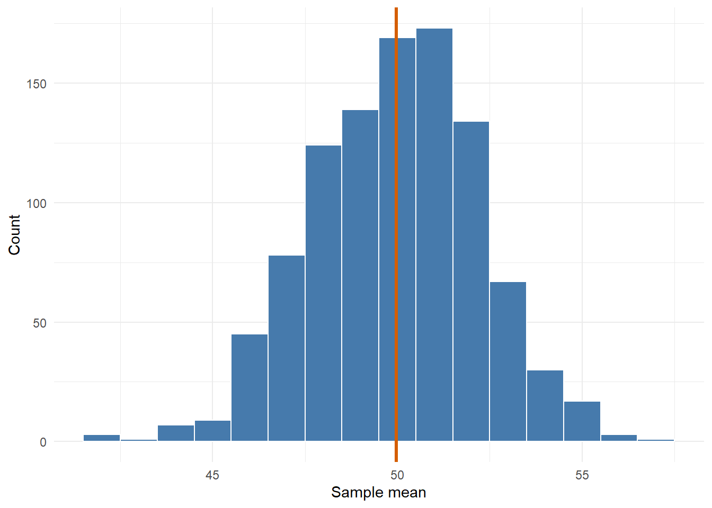
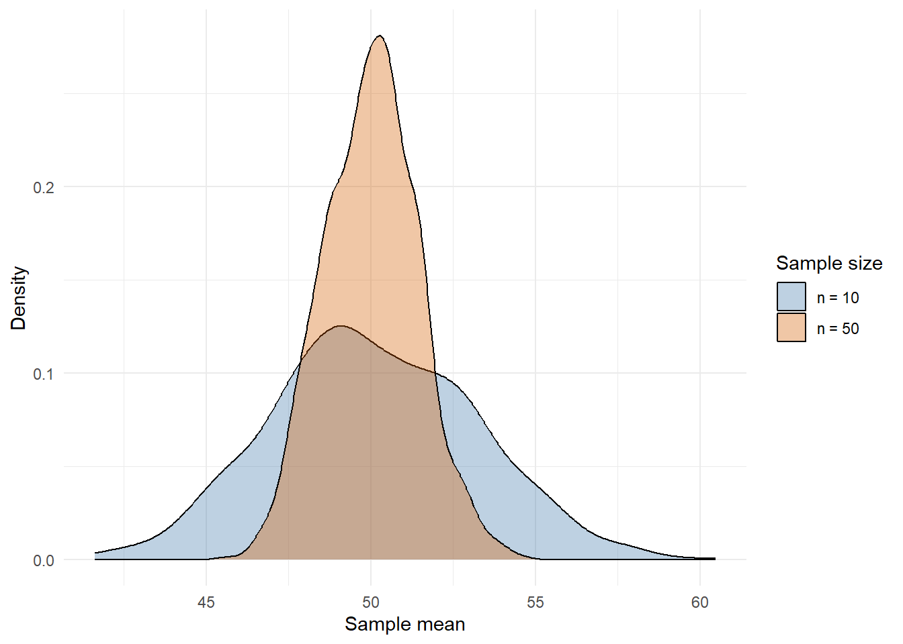

# From Spread To Standard Error

## Reusing The Same Pieces

In the last chapter, we built variance by taking an equation and turning it into a set of small R steps.

That same idea works for lots of summary statistics. We will use the mean, variance, and standard deviation to build towards standard error.

The path is:

```text
values -> mean -> variance -> standard deviation -> standard error
```

Standard deviation describes how spread out the values are. Standard error describes how much a mean would vary across repeated samples.

We will use this small vector:


``` r
x <- score_values
x
#> [1] 48 51 49 54 52 50 53 51
```

## A Mean Function

The mean is just the total divided by the number of values.


``` r
my_mean <- function(x) {
  total <- sum(x)
  n <- length(x)
  output <- total / n
  return(output)
}

my_mean(x)
#> [1] 51
mean(x)
#> [1] 51
```

This is not better than `mean()`. The point is to see what `mean()` is doing for us.

The input is <input class='webex-solveme nospaces' size='1' data-answer='["x"]'/>. The output is one number: the mean.

## A Variance Function

Here is the variance function from the last chapter, kept here so we can reuse it.


``` r
my_var <- function(x) {
  n <- length(x)
  mean_x <- my_mean(x)
  squared_distances <- (x - mean_x)^2
  total_squared_distance <- sum(squared_distances)

  output <- total_squared_distance / (n - 1)
  return(output)
}

my_var(x)
#> [1] 4
var(x)
#> [1] 4
```

We now have a small function that does one useful job.

## Standard Deviation

Standard deviation is the square root of variance.


``` r
my_sd <- function(x) {
  output <- sqrt(my_var(x))
  return(output)
}

my_sd(x)
#> [1] 2
sd(x)
#> [1] 2
```

Notice how the function is getting shorter. Once `my_var()` exists, `my_sd()` can use it.

This is one of the nicest things about functions: once you trust a small piece, you can build with it.

## Standard Error

Standard deviation describes the spread of values in a sample.

Standard error describes the spread of sample means.

That is a different kind of spread. Instead of asking how much individual scores vary, we ask how much the mean would vary if we repeated the sampling process.

The standard error is:

$$
SE = \frac{s}{\sqrt{n}}
$$

where `s` is the sample standard deviation and `n` is the number of values.

In R:


``` r
my_se <- function(x) {
  n <- length(x)
  output <- my_sd(x) / sqrt(n)
  return(output)
}

my_se(x)
#> [1] 0.7071068
sd(x) / sqrt(length(x))
#> [1] 0.7071068
```

Again, the formula and the function are doing the same thing. One is mathematical notation; the other is R notation.

What does `sqrt(n)` mean here? <select class='webex-select'><option value='blank'></option><option value=''>the variance</option><option value='answer'>the square root of the sample size</option><option value=''>the mean</option></select>

## Seeing Standard Error

We can use simulation to see why standard error is about sample means.

First, imagine a large population of scores.


``` r
population_scores <- rnorm(n = 10000, mean = 50, sd = 10)

population_summary <- tibble(score = population_scores) %>%
  summarise(
    mean_score = mean(score),
    sd_score = sd(score)
  )

population_summary
```

<div class="kable-table">

| mean_score| sd_score|
|----------:|--------:|
|   49.97628| 9.986366|

</div>

The population has lots of individual values. We can draw one sample and calculate one sample mean.


``` r
one_sample <- sample(population_scores, size = 20)
mean(one_sample)
#> [1] 48.49899
```

If we repeat that process many times, we get many sample means.


``` r
one_sample_mean <- function(n) {
  one_sample <- sample(population_scores, size = n)
  mean(one_sample)
}

sample_means_20 <- replicate(1000, one_sample_mean(n = 20))
```

Now we can plot the distribution of those sample means.


``` r
sample_mean_data <- tibble(mean_score = sample_means_20)

ggplot(sample_mean_data, aes(x = mean_score)) +
  geom_histogram(binwidth = 1, colour = "white", fill = "#467AAC") +
  geom_vline(
    xintercept = mean(sample_means_20),
    linewidth = 1.2,
    colour = "#D55E00"
  ) +
  labs(x = "Sample mean", y = "Count") +
  theme_minimal()
```

<div class="figure">

<p class="caption">(\#fig:sample-means-visual)A sampling distribution of sample means.</p>
</div>

The x-axis is now sample means, not individual scores. The spread of this distribution is the standard error.


``` r
sd(sample_means_20)
#> [1] 2.253091
sd(population_scores) / sqrt(20)
#> [1] 2.233019
```

The first line estimates the standard error by simulation. The second line calculates it from the formula.

## Sample Size And Standard Error

Larger samples give less variable sample means.


``` r
sample_means_10 <- replicate(1000, one_sample_mean(n = 10))
sample_means_50 <- replicate(1000, one_sample_mean(n = 50))

sample_size_data <- tibble(
  mean_score = c(sample_means_10, sample_means_50),
  sample_size = c(
    rep("n = 10", length(sample_means_10)),
    rep("n = 50", length(sample_means_50))
  )
)
```


``` r
ggplot(sample_size_data, aes(x = mean_score, fill = sample_size)) +
  geom_density(alpha = .35) +
  scale_fill_manual(values = c("n = 10" = "#467AAC", "n = 50" = "#D55E00")) +
  labs(x = "Sample mean", y = "Density", fill = "Sample size") +
  theme_minimal()
```

<div class="figure">

<p class="caption">(\#fig:sample-size-visual)Larger samples give a narrower distribution of sample means.</p>
</div>

The `n = 50` distribution is narrower because larger samples give more stable means.

That is why `n` sits in the denominator of the standard error formula:

```text
SE = SD / sqrt(n)
```

## A Small Summary Function

We can also return several related values at once.


``` r
my_summary <- function(x) {
  output <- tibble(
    n = length(x),
    mean = my_mean(x),
    variance = my_var(x),
    sd = my_sd(x),
    se = my_se(x)
  )

  return(output)
}

my_summary(x)
```

<div class="kable-table">

|  n| mean| variance| sd|        se|
|--:|----:|--------:|--:|---------:|
|  8|   51|        4|  2| 0.7071068|

</div>

This is a useful pattern for the rest of the resource:

1. make a tiny function;
2. check it against base R;
3. reuse it inside the next function;
4. keep the inputs and outputs clear.

## Your Turn

Make a function called `z_score()` that turns values into z-scores.

The recipe is:

1. calculate the mean;
2. subtract the mean from each value;
3. divide by the standard deviation.


``` r
z_score <- function(x) {
  mean_x <- 
  sd_x <- 
  output <- 
  return(output)
}

z_score(x)
```


<div class='webex-solution'><button>Show one solution</button>


``` r
z_score <- function(x) {
  mean_x <- my_mean(x)
  sd_x <- my_sd(x)
  output <- (x - mean_x) / sd_x
  return(output)
}

z_score(x)
#> [1] -1.5  0.0 -1.0  1.5  0.5 -0.5  1.0  0.0
```

</div>


## Where This Goes Next

The same structure can be extended to specific statistical tests.

For now, the important bit is the method:

<div class="summary-box">
Break the scary-looking thing into small functions, check each part, then put the pieces together.
</div>
