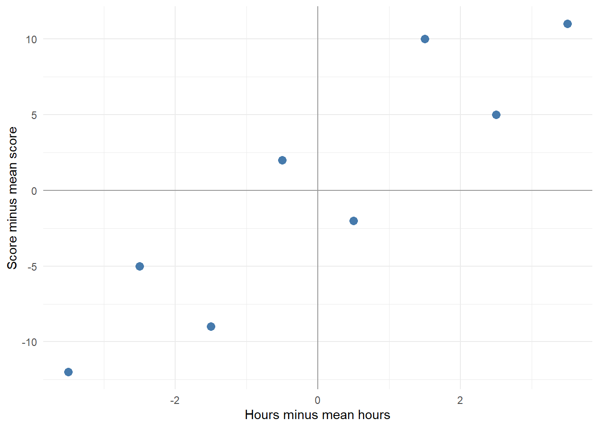

# Covariance And Correlation

## Two Values Per Person

So far, each person has given us one score. What happens when we measure two things about each person?

Imagine recording practice time and a test score. These are made-up data for eight people. Each row belongs to one person, so the two values in that row go together.


``` r
practice <- tibble(
  hours = c(1, 2, 3, 4, 5, 6, 7, 8),
  score = c(48, 55, 51, 62, 58, 70, 65, 71)
)

practice
```

<div class="kable-table">

| hours| score|
|-----:|-----:|
|     1|    48|
|     2|    55|
|     3|    51|
|     4|    62|
|     5|    58|
|     6|    70|
|     7|    65|
|     8|    71|

</div>


``` r
ggplot(practice, aes(x = hours, y = score)) +
  geom_point(size = 3, colour = "#467AAC") +
  labs(x = "Practice time (hours)", y = "Test score") +
  theme_minimal()
```

<div class="figure">

<p class="caption">(\#fig:paired-scatter)Each point represents one person. People with more practice hours tend to have higher scores.</p>
</div>

There is an upward pattern, but the points do not lie on a straight line. We want a number that describes the direction and strength of this linear relationship.

## Two Distances From The Mean

For variance, we subtracted a mean from each value. We can do that for both variables. Here are the functions we have already built, so you can run this chapter on its own.


``` r
my_mean <- function(x) {
  return(sum(x) / length(x))
}

my_var <- function(x) {
  return(sum((x - my_mean(x))^2) / (length(x) - 1))
}

my_sd <- function(x) {
  return(sqrt(my_var(x)))
}

x <- pull(practice, hours)
y <- pull(practice, score)

mean_x <- my_mean(x)
mean_y <- my_mean(y)

deviations <- practice %>%
  mutate(
    dx = hours - mean_x,
    dy = score - mean_y,
    product = dx * dy
  )

deviations
```

<div class="kable-table">

| hours| score|   dx|  dy| product|
|-----:|-----:|----:|---:|-------:|
|     1|    48| -3.5| -12|    42.0|
|     2|    55| -2.5|  -5|    12.5|
|     3|    51| -1.5|  -9|    13.5|
|     4|    62| -0.5|   2|    -1.0|
|     5|    58|  0.5|  -2|    -1.0|
|     6|    70|  1.5|  10|    15.0|
|     7|    65|  2.5|   5|    12.5|
|     8|    71|  3.5|  11|    38.5|

</div>

`dx` tells us how far someone's practice time is above or below the mean practice time. `dy` does the same for their score.


``` r
ggplot(deviations, aes(x = dx, y = dy)) +
  geom_hline(yintercept = 0, colour = "grey60") +
  geom_vline(xintercept = 0, colour = "grey60") +
  geom_point(size = 3, colour = "#467AAC") +
  labs(x = "Hours minus mean hours", y = "Score minus mean score") +
  theme_minimal()
```

<div class="figure">

<p class="caption">(\#fig:paired-deviations)Zero on each axis means the corresponding variable's mean. Matching signs give positive products; opposite signs give negative products.</p>
</div>

Now multiply the two distances for each person:

- Above both means: positive times positive gives a positive product.
- Below both means: negative times negative also gives a positive product.
- Above one mean and below the other: the product is negative.

If one person's `dx` is -2 and their `dy` is -3, their product is <input class='webex-solveme nospaces' size='1' data-answer='["6"]'/>.

## Covariance

Add those products and divide by the number of pairs minus one. That gives us the sample covariance:

$$
s_{xy} = \frac{\sum_{i=1}^{n}(x_i - \bar{x})(y_i - \bar{y})}{n-1}
$$

The subscript $i$ keeps each person's two values together. $n$ is the number of pairs. The summation sign tells us to add the products.


``` r
dx <- x - my_mean(x)
dy <- y - my_mean(y)
products <- dx * dy
sum(products) / (length(x) - 1)
#> [1] 18.85714
```

Let's put those steps into a function with two inputs.


``` r
my_covariance <- function(x, y) {
  dx <- x - my_mean(x)
  dy <- y - my_mean(y)
  products <- dx * dy
  output <- sum(products) / (length(x) - 1)
  return(output)
}

my_covariance(x, y)
#> [1] 18.85714
cov(x, y)
#> [1] 18.85714
```

`cov()` is R's sample covariance function. Our version expects two numeric vectors of the same length, with at least two complete pairs and no missing values. Keep the rows paired: sorting one variable on its own would change who goes with whom.

Our covariance is positive. On balance, people above the mean on practice time are also above the mean on test score, and people below one mean are below the other.

What happens if we put the same variable into both inputs?


``` r
my_covariance(x, x)
#> [1] 6
my_var(x)
#> [1] 6
```

We multiply each deviation by itself, so the products become squared deviations. Covariance of a variable with itself is its variance.

## Why Standardise?

Covariance depends on the units. Change hours to minutes and we multiply every practice-time deviation by 60.


``` r
my_covariance(x, y)
#> [1] 18.85714
my_covariance(x * 60, y)
#> [1] 1131.429
```

The people and their scores have not changed, but the covariance is now 60 times larger. To describe strength without depending on these units, divide by the product of the two standard deviations:

$$
r = \frac{s_{xy}}{s_x s_y}
$$

This is Pearson's correlation coefficient, $r$.


``` r
my_correlation <- function(x, y) {
  covariance <- my_covariance(x, y)
  sd_x <- my_sd(x)
  sd_y <- my_sd(y)
  output <- covariance / (sd_x * sd_y)
  return(output)
}

my_correlation(x, y)
#> [1] 0.9072647
cor(x, y)
#> [1] 0.9072647
my_correlation(x * 60, y)
#> [1] 0.9072647
```

Our correlation is 0.91. It describes a strong positive linear association in these eight observations. Multiplying hours by 60 also multiplies its SD by 60, so the change cancels when we divide.

Correlation ranges from -1 to 1. Both ends describe a perfect straight-line relationship; the sign gives its direction. A value near zero describes little linear association. There can still be a curved relationship, so always look at the scatterplot too. If either variable has zero SD, correlation is undefined because we would divide by zero.

Changing hours to minutes makes Pearson's correlation <select class='webex-select'><option value='blank'></option><option value='answer'>stay the same</option><option value=''>60 times larger</option><option value=''>negative</option></select>.

## Try It Interactively

Change the relationship slider and watch the paired deviations. Blue points have positive products and orange points have negative products. The table gives the numbers for each point.

<iframe src="apps/correlation/embed.html" width="100%" height="900" title="Explore covariance and correlation" style="border: 0;"></iframe>

1. Set the relationship to zero. Do the positive and negative products cancel?
2. Set a positive relationship, then double the scale of y. Predict which of covariance and correlation will change.
3. Choose a negative relationship. Explain why most products are now negative.


<div class='webex-solution'><button>Show explanations</button>

At zero, the products sum to zero in this constructed example. Doubling the scale of y doubles covariance and its SD, so correlation stays the same. A negative relationship mostly pairs above-mean values of one variable with below-mean values of the other.

The slider constructs data with a chosen sample correlation. It does not draw a new random sample each time. A random sample from a population with zero correlation will usually have a sample correlation a little above or below zero.

</div>


## Your Turn

Use the practice data to check two predictions:

1. Adding 10 to every score leaves the correlation unchanged.
2. Reversing the sign of every score reverses the correlation's sign.


``` r
my_correlation(x, y + 10)
my_correlation(x, -y)
```

Explain each result using deviations from the mean.


<div class='webex-solution'><button>Show one solution</button>


``` r
my_correlation(x, y + 10)
#> [1] 0.9072647
my_correlation(x, -y)
#> [1] -0.9072647
```
Adding 10 increases every score and the mean by 10, leaving deviations unchanged. Multiplying by -1 reverses every score deviation. That reverses the products and covariance, while SD stays positive.

</div>


## A t-Value Again

Our sample correlation describes the data we have. We can also test a null hypothesis that the population Pearson correlation is zero.

For independent pairs drawn from a bivariate normal population, the following statistic follows a t-distribution under that null hypothesis:

$$
t = r\sqrt{\frac{n-2}{1-r^2}}, \qquad df = n-2
$$

Here $n$ is the number of pairs. Unlike our one-sample t-test, the degrees of freedom are $n-2$. This is also the residual degrees of freedom in a simple regression with an intercept and one slope.


``` r
my_correlation_t <- function(x, y) {
  r <- my_correlation(x, y)
  n <- length(x)
  output <- r * sqrt((n - 2) / (1 - r^2))
  return(output)
}

my_correlation_t(x, y)
#> [1] 5.284229
cor.test(x, y, method = "pearson")
#> 
#> 	Pearson's product-moment correlation
#> 
#> data:  x and y
#> t = 5.2842, df = 6, p-value = 0.001858
#> alternative hypothesis: true correlation is not equal to 0
#> 95 percent confidence interval:
#>  0.5617016 0.9832936
#> sample estimates:
#>       cor 
#> 0.9072647
```

This calculation needs at least three complete pairs and a correlation strictly between -1 and 1. Our small teaching functions do not check these conditions for us.


The t-values match. For our data, t is 5.28 with 6 degrees of freedom. The two-sided p-value is 0.00186. Under the stated assumptions, this is evidence against zero population correlation at alpha .05.

The p-value describes how unusual a result this far from zero would be under that null model. It does not tell us whether practice caused the higher scores. These made-up observations also cannot establish anything about real students.

## Link Back And Next Step

Variance used squared deviations from one mean. Covariance used paired deviations from two means. Dividing covariance by two SDs gave us correlation. Testing that correlation brought us back to a t-distribution.

Next we can ask a different question: given someone's practice time, what score would we predict? A regression line turns that prediction into another function.
