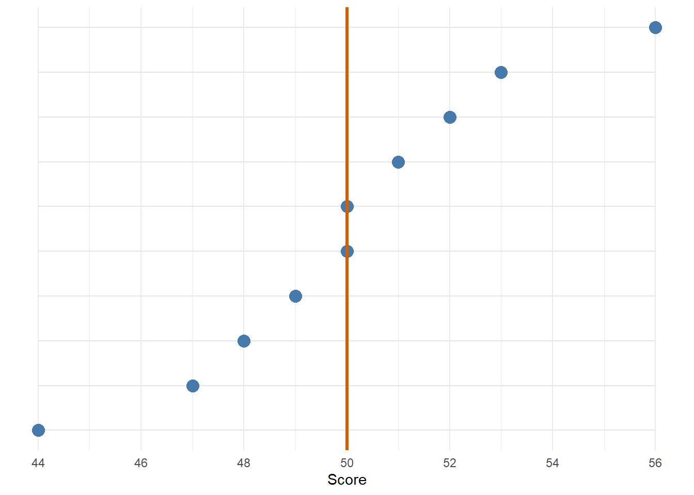
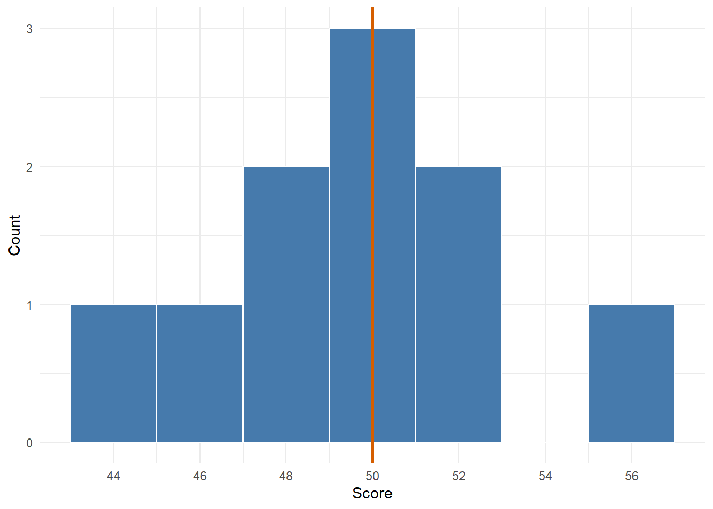
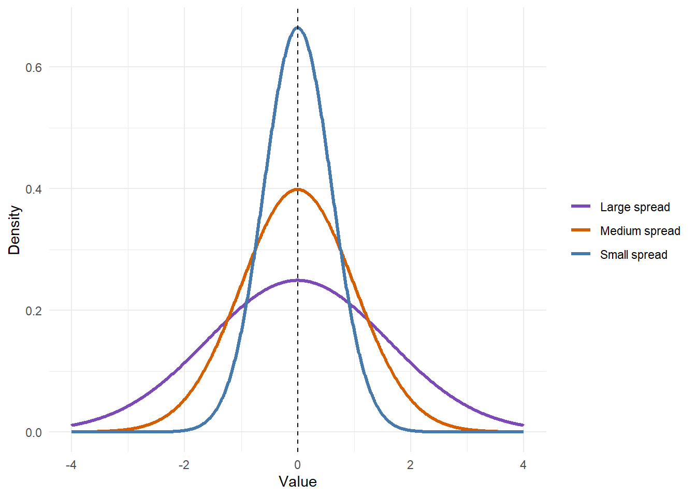

# From Equations to Code {#equations}

## Equations are Blueprints

A statistical equation can look intimidating because it compresses a lot of instructions into a small space. R code can help us unfold those instructions.

This chapter focuses on the mean and variance. The mean tells us where the centre of a set of values is. Variance tells us how spread out the values are around that centre.

The rough path from the raw set of values all the way to a standard deviation function is:

```text
values -> mean -> distances from the mean -> variance -> standard deviation
```

This is the first bit of the wider tree. We start with raw values, then build the summaries that later become standard error and the t-statistic.

## Files For This Chapter

You will write your own functions in RStudio as you read. Download these two files and save them in the same folder:

- <a href="exercises/1b-equations-exercises.Rmd" download>1b-equations-exercises.Rmd</a>: the exercises from this chapter with blanks for you to fill in;
- <a href="exercises/my_functions.R" download>my_functions.R</a>: your toolbox. You will add each function you build to this file and reuse them in later chapters.

Open the exercise file in RStudio and keep this page open next to it. When the book asks you to write a function, write it in the exercise file and run it there.

## Seeing The Mean

Let us start with a small set of values.


``` r
x <- c(44, 47, 48, 49, 50, 50, 51, 52, 53, 56)
mean_x <- mean(x)

scores <- tibble(value = x)
scores
```

<div class="kable-table">

| value|
|-----:|
|    44|
|    47|
|    48|
|    49|
|    50|
|    50|
|    51|
|    52|
|    53|
|    56|

</div>

Their mean is 50.

The mean is the balance point of the values. In the graph below, each dot is one value on the x-axis and the orange line is the mean.

<div class="figure">

<p class="caption">(\#fig:mean-visual)The mean as the centre of a small set of values.</p>
</div>


<div class='webex-solution'><button>Show the plot code</button>

``` r
mean_data <- tibble(
  value = x,
  y = 1:length(x)
)

ggplot(mean_data, aes(x = value, y = y)) +
  geom_segment(
    aes(x = min(x), xend = max(x), y = y, yend = y),
    colour = "grey90"
  ) +
  geom_point(size = 4, colour = "#467AAC") +
  geom_vline(xintercept = mean_x, linewidth = 1.2, colour = "#D55E00") +
  scale_x_continuous(breaks = seq(44, 56, 2)) +
  scale_y_continuous(NULL, breaks = NULL) +
  labs(x = "Score") +
  theme_minimal()
```


</div>

The orange line happens to land on 50, which is also one of the values, but that is a coincidence: the mean is calculated from all ten values together.

What is the mean of `c(44, 47, 48, 49, 50, 50, 51, 52, 53, 56)`? <input class='webex-solveme nospaces' size='2' data-answer='["50"]'/>

## Building A Mean Function

You have probably calculated a mean before: add everything up, then divide by how many things you added. We are going to write that recipe as an equation, pull the equation apart, and turn each part into a line of R. By the end you will have your own mean function. The variance, standard deviation, standard error, and t-statistic functions later in the book are all built on top of it.

### The Mean Equation

Here is the mean written as an equation:

$$
\bar{x} = \frac{\sum_{i=1}^{n} x_i}{n}
$$

Each symbol has a job:

| Maths | Read it as | R |
|-----|--------------------|----------|
| $x$ | the set of values | `x` |
| $x_i$ | one value from the set; $i$ says which one, so $x_1$ is the first value and $x_2$ is the second | |
| $n$ | how many values there are | `length(x)` |
| $\sum_{i=1}^{n}$ | add up every value, from the first ($i = 1$) to the last ($i = n$) | `sum()` |
| $\bar{x}$ | the mean of $x$, said "x bar" | what our function returns |

Put into words, the equation says: **add up every value of $x$, then divide by how many values there are.**

### Step 1: Add Up The Values

The $\sum$ symbol is a capital Greek letter sigma, and it stands for "sum". It tends to be the bit that puts people off, but all it asks for is repeated addition. With our ten values, we could write every step out:


``` r
44 + 47 + 48 + 49 + 50 + 50 + 51 + 52 + 53 + 56
```

```
## [1] 500
```

That works, but it would be miserable with 200 values, and we would have to retype it every time the data changed. The `sum()` function does the same repeated addition for any vector we give it:


``` r
total <- sum(x)
total
```

```
## [1] 500
```

Same answer. Whenever you see $\sum$ in an equation, you can expect `sum()` somewhere in the R code.

The total of the values in `x` is <input class='webex-solveme nospaces' size='3' data-answer='["500"]'/>.

### Step 2: Count The Values

The `length()` function tells us how many values are in a vector. That is our $n$.


``` r
n <- length(x)
n
```

```
## [1] 10
```

### Step 3: Divide

The last part of the equation is the fraction line: the total goes on top and $n$ goes underneath. You now have both pieces saved, as `total` and `n`. Write the line that divides one by the other:


``` r
mean_value <-
mean_value
```


<div class='webex-solution'><button>Show a hint</button>

In R, `/` divides. The top of the fraction goes before it and the bottom goes after it.

</div>


<div class='webex-solution'><button>Show one solution</button>


``` r
mean_value <- total / n
mean_value
```

```
## [1] 50
```

</div>


That is the mean, and it is the same value the orange line marked in the plot above.

### Your Turn: Write `my_mean()`

Now put the three steps inside a function, using the same shape as the functions in Chapter \@ref(functions):

- the input is a vector of values, `x`;
- the process is add up, count, then divide;
- the output is the mean.

Fill in the blanks below.


``` r
my_mean <- function(x) {
  total <-
  n <-
  output <-
  return(output)
}

my_mean(x)
```


<div class='webex-solution'><button>Show a hint</button>

Each blank is one of the steps above. `total` uses `sum()`, `n` uses `length()`, and `output` divides one by the other.

</div>


<div class='webex-solution'><button>Show one solution</button>


``` r
my_mean <- function(x) {
  total <- sum(x)
  n <- length(x)
  output <- total / n
  return(output)
}

my_mean(x)
```

```
## [1] 50
```

</div>


### Check It Against `mean()`

R already has a mean function, `mean()`, which comes with R in the `stats` package. Every function you build in this book gets checked against the version R provides. If the two agree, you have reproduced exactly what the professional version does.

The check has two parts. First, print both answers so you can see them side by side. Putting them inside `c()` and giving each one a name, `mine` and `R`, labels the output so you can tell which answer is which:


``` r
c(mine = my_mean(x), R = mean(x))
```

```
## mine    R 
##   50   50
```

Second, ask R to compare them for you with `all.equal()`:


``` r
all.equal(my_mean(x), mean(x))
```

```
## [1] TRUE
```

`all.equal()` takes two results and returns `TRUE` if they match. If they do not match, it tells you how far apart they are instead. We use it rather than `==` because computers sometimes produce tiny differences far past the tenth decimal place when they do the same calculation in a slightly different order. `all.equal()` ignores those, so a `TRUE` means the answers really are the same.

One example could match by luck, so check a second set of values too. `score_values` holds eight test scores, the `score` column from the `demo_scores` data in Chapter \@ref(functions):


``` r
score_values <- c(48, 51, 49, 54, 52, 50, 53, 51)

c(mine = my_mean(score_values), R = mean(score_values))
all.equal(my_mean(score_values), mean(score_values))
```

```
## mine    R 
##   51   51 
## [1] TRUE
```

If you get `TRUE` both times, your function does what `mean()` does. If you do not, check the brackets and the order of the steps. A common slip is dividing by the wrong thing.

Which line in `my_mean()` counts how many values are in `x`? <select class='webex-select'><option value='blank'></option><option value=''>total <- sum(x)</option><option value='answer'>n <- length(x)</option><option value=''>return(output)</option></select>

Before you run it, work out the mean of `c(2, 4, 9)` in your head. Then check it with `my_mean(c(2, 4, 9))`. The mean is <input class='webex-solveme nospaces' size='1' data-answer='["5"]'/>.

### What The Mean Tells Us

That last example has a mean of 5, and 5 is not one of the values. The mean summarises all the values at once, so it does not have to match any of them.

It is also the **balance point** of the values. If we take each value's distance from the mean, the distances below the mean and the distances above it cancel each other out exactly:


``` r
x - my_mean(x)
sum(x - my_mean(x))
```

```
##  [1] -6 -3 -2 -1  0  0  1  2  3  6
## [1] 0
```

The negative and positive distances add up to zero. That is what "balance point" means, and it happens with any set of values. Try it with `score_values` or `c(2, 4, 9)`.

Keep this result in mind. Next we want to measure how spread out the values are using their distances from the mean. Simply adding those distances up will always give zero, so we will need another step.

## Seeing Distances From The Mean

Variance starts by asking how far each value is from the mean.

<div class="figure">

<p class="caption">(\#fig:distance-visual)Each value has a distance from the mean.</p>
</div>


<div class='webex-solution'><button>Show the plot code</button>

``` r
distance_data <- tibble(
  value = x,
  mean = mean_x,
  y = 1:length(x)
)

ggplot(distance_data) +
  geom_segment(
    aes(x = min(x), xend = max(x), y = y, yend = y),
    colour = "grey90"
  ) +
  geom_segment(
    aes(x = mean, xend = value, y = y, yend = y),
    colour = "#D55E00",
    linewidth = 1,
    alpha = .65
  ) +
  geom_point(aes(x = value, y = y), size = 3.5, colour = "#467AAC") +
  geom_vline(xintercept = mean_x, linewidth = 1.1, colour = "#D55E00") +
  scale_x_continuous(breaks = seq(44, 56, 2)) +
  scale_y_continuous(NULL, breaks = NULL) +
  labs(x = "Score") +
  theme_minimal()
```


</div>

The orange line segments are the distances from each value to the mean. Some values are close to the mean and some are further away. Variance is a way of turning all those distances into one number.

## From Points To A Distribution

The same values can also be shown as a small distribution.

<div class="figure">

<p class="caption">(\#fig:value-distribution)The same values shown as a small distribution.</p>
</div>


<div class='webex-solution'><button>Show the plot code</button>

``` r
ggplot(scores, aes(x = value)) +
  geom_histogram(
    binwidth = 2,
    boundary = 43,
    colour = "white",
    fill = "#467AAC"
  ) +
  geom_vline(xintercept = mean_x, linewidth = 1.2, colour = "#D55E00") +
  scale_x_continuous(breaks = seq(44, 56, 2)) +
  labs(x = "Score", y = "Count") +
  theme_minimal()
```


</div>

This is the same x-axis as the dot plot. The values are exactly the same, but we are viewing it in a different way. We are showing which values (or small ranges of values) show up the most in the data, since the height of the bars in the histogram show how many values lie in that range (or "bin").

That allows us to move further along the process of summarising the data:

```text
individual points -> distribution of values -> summaries of that distribution
```

## Seeing Variance

Here are three distributions with the same mean but different standard deviations.

<div class="figure">

<p class="caption">(\#fig:variance-visual)Same mean, different spread.</p>
</div>


<div class='webex-solution'><button>Show the plot code</button>

``` r
dist_x <- seq(-4, 4, 0.01)

dist_data <- tibble(
  value = c(dist_x, dist_x, dist_x),
  density = c(
    dnorm(dist_x, mean = 0, sd = 0.6),
    dnorm(dist_x, mean = 0, sd = 1.0),
    dnorm(dist_x, mean = 0, sd = 1.6)
  ),
  spread = c(
    rep("Small spread", length(dist_x)),
    rep("Medium spread", length(dist_x)),
    rep("Large spread", length(dist_x))
  )
)

ggplot(dist_data, aes(x = value, y = density, colour = spread)) +
  geom_line(linewidth = 1.1) +
  geom_vline(xintercept = 0, linetype = "dashed") +
  scale_colour_manual(values = c(
    "Small spread" = "#467AAC",
    "Medium spread" = "#D55E00",
    "Large spread" = "#7B4AB8"
  )) +
  labs(x = "Value", y = "Density", colour = NULL) +
  theme_minimal()
```


</div>

All three curves are centred in the same place. The difference is how far the values tend to sit from that centre. This is the visual idea behind variance.

## Try It Interactively

Use the widget below to change the mean and variance of a normal distribution.

<iframe src="apps/mean-variance/embed.html" width="100%" height="720" title="Mean and variance interactive widget" style="border: 0;"></iframe>

Move the mean and the whole distribution shifts left or right. Increase the variance and the distribution spreads out. Decrease the variance and it gets tighter. You can also switch the dots and the bell curve on and off to focus on one part at a time.

## The Variance Equation

Now we can connect the picture to the equation:

$$
s^2 = \frac{\sum_{i=1}^{n}(x_i - \bar{x})^2}{n-1}
$$

The formula says:

1. take each value in `x`;
2. subtract the mean of `x`;
3. square that distance;
4. add all the squared distances together;
5. divide by `n - 1`.

So although it might look scary, all it actually is is repeated subtraction, squaring, addition, and division.

## Notation To R

You met most of these symbols in the mean equation. The new piece is the squared distance from the mean.

| Maths | Meaning | R |
|---|---|---|
| $x$ | a vector of values | `x` |
| $n$ | number of values | `length(x)` |
| $\bar{x}$ | mean of `x` | `my_mean(x)` |
| $(x_i - \bar{x})^2$ | squared distance from the mean | `(x - mean_x)^2` |
| $\sum$ | add repeated values | `sum()` |

As with the mean, read $\sum$ as:

<div class="summary-box">
Do this same calculation for every value, then add the results with `sum()`.
</div>

## Squared Distances

Variance is based on distances from the mean. We will keep using the ten values from the start of the chapter, so the mean is still 50:


``` r
mean_x <- my_mean(x)
```

Before writing the whole function, work out the middle of the equation yourself. Use `mutate()` to add two columns to `scores`, the table we made at the start of the chapter:

- `distance`: each value minus the mean;
- `squared`: each distance, squared.


``` r
mutate(
  scores,
  distance = ,
  squared =
)
```


<div class='webex-solution'><button>Show a hint</button>

The values are in the `value` column and the mean is in `mean_x`. `^2` squares a number. `mutate()` can use a column it has only just made, so `squared` can build on `distance`.

</div>


<div class='webex-solution'><button>Show one solution</button>


``` r
mutate(
  scores,
  distance = value - mean_x,
  squared = distance^2
)
```

<div class="kable-table">

| value| distance| squared|
|-----:|--------:|-------:|
|    44|       -6|      36|
|    47|       -3|       9|
|    48|       -2|       4|
|    49|       -1|       1|
|    50|        0|       0|
|    50|        0|       0|
|    51|        1|       1|
|    52|        2|       4|
|    53|        3|       9|
|    56|        6|      36|

</div>

</div>


Squaring makes every distance positive, so the distances below the mean and above it no longer cancel each other out. Which values have the largest squared distance? <select class='webex-select'><option value='blank'></option><option value='answer'>44 and 56</option><option value=''>50 and 50</option><option value=''>47 and 53</option></select>

Next, add the squared distances up. A function will not have a `scores` table to work with, only the vector `x`, so do this step with `x`. `x - mean_x` gives the same distances as the `distance` column, because `x` holds the same values as `value`. Square them and add them up with `sum()`:


``` r
sum()
```

The total squared distance is <input class='webex-solveme nospaces' size='3' data-answer='["100"]'/>.


<div class='webex-solution'><button>Show one solution</button>


``` r
sum((x - mean_x)^2)
```

```
## [1] 100
```

</div>


That total is the numerator of the variance equation. The rest of the equation turns it into an average squared distance.

## Your Turn: Write `my_var()`

Now we can build the whole formula. Each line of the function is one step from the list under the variance equation:

1. count the values;
2. calculate the mean, using your own `my_mean()`;
3. square each distance from the mean;
4. add the squared distances together;
5. divide by `n - 1`.

Fill in the blanks below.


``` r
my_var <- function(x) {
  n <-
  mean_x <-
  squared_distances <-
  total_squared_distance <-

  output <-
  return(output)
}

my_var(x)
```


<div class='webex-solution'><button>Show a hint</button>

You worked out the middle of this in the Squared Distances section. `mean_x` uses `my_mean(x)`, `squared_distances` is the squared distances you added up there, and `total_squared_distance` adds them with `sum()`. Put brackets around `n - 1` when you divide.

</div>


<div class='webex-solution'><button>Show one solution</button>


``` r
my_var <- function(x) {
  n <- length(x)
  mean_x <- my_mean(x)
  squared_distances <- (x - mean_x)^2
  total_squared_distance <- sum(squared_distances)

  output <- total_squared_distance / (n - 1)
  return(output)
}

my_var(x)
```

```
## [1] 11.11111
```

</div>


Notice that `my_var()` uses `my_mean()` inside it. Your variance function is built on your mean function.

## Check It Against `var()`

R's version is `var()`, also from the `stats` package. Run the same two-part check as before: print both answers, then compare them with `all.equal()`.


``` r
c(mine = my_var(x), R = var(x))
all.equal(my_var(x), var(x))
```

```
##     mine        R 
## 11.11111 11.11111 
## [1] TRUE
```

And on a second set of values:


``` r
c(mine = my_var(score_values), R = var(score_values))
all.equal(my_var(score_values), var(score_values))
```

```
## mine    R 
##    4    4 
## [1] TRUE
```

Two `TRUE`s means your function reproduces `var()`.

What does `length(x)` give us in this formula? <select class='webex-select'><option value='blank'></option><option value='answer'>the number of values</option><option value=''>the largest value</option><option value=''>the mean</option></select>

## Why Divide By `n - 1`?

For sample variance, we divide by `n - 1` rather than `n`. The short version is that we are using the sample mean as an estimate of the population mean, and that costs us one degree of freedom.

As a brief explanation, when we estimate something about a population from a sample, that estimate puts a constraint on the sample. One of the values is no longer **free to vary**. For example, say we use the ten values from the start of this chapter to estimate the population mean. Our best estimate is the sample mean, $\bar{x} = 50$, which means the ten values must add up to 500. If the first nine values are 44, 47, 48, 49, 50, 50, 51, 52 and 53, they add up to 444, so the tenth value **has** to be 56. No other number would give us a mean of 50. It is **not free to vary**.

You have already seen this from another angle: the distances from the mean always add up to zero. Once you know nine of them, the tenth is decided. Since variance is built from those distances, only $n - 1$ of them are free to vary, and that is what we divide by.


<div class='webex-solution'><button>Bonus: more on degrees of freedom</button>

**Where else you will see it**

Each estimate we use costs one degree of freedom. You will see this again in the t-test, and later in regression, where we estimate two things (an intercept and a slope) and lose two degrees of freedom. It comes from using an estimate from the sample that fills in for a population parameter we can't see.

**Which value is not free to vary?**

The 56 is not special. There is technically no "last" value, because we could write the values out or add them up in any order we want. The constraint applies equally to all of them. It is a statement about the relationship between the values and the estimate we derive from them, not about any single value.

Think of the angles in a triangle. We know they add up to 180, so if we know two of them, the third is not free to vary: it can only be one number. But that is not true of one particular angle. They all equally constrain each other.

If I am being honest, I always found this concept a bit paradoxical and hard to get my head around: how can it constrain all of the values and none of them at the same time? The answer is that it is a **rule linking the values together** that is fixed, not a specific value. One rule costs one piece of information, so we only need to know $n - 1$ of the values to work out the last one, whichever one we leave until last. 

If that still makes zero sense to you, the good news is that you do not need to be able to write the proof for the equation we decide to use - we can just trust the brainboxes that have already gone to the trouble, and as long as you understand the concept behind it you are fine!

</div>


Dividing by `n - 1` is part of the blueprint, so our function needs to do it, and you can check that `var()` does the same.

Try changing the final line of `my_var()` to divide by `n` instead, then run the `all.equal()` check again. Does it still match `var()`?


<div class='webex-solution'><button>Expected result</button>

No. Instead of `TRUE`, `all.equal()` reports `"Mean relative difference: 0.1111111"`. That is what a failed check looks like: R tells you the answers differ, and by how much. R's `var()` calculates sample variance, so it divides by `n - 1`. Change your function back before moving on.

</div>


## Standard Deviation

Standard deviation is the square root of variance:

$$
s = \sqrt{s^2}
$$

Work out the standard deviation of `x` from your `my_var()`, then check it against R's `sd()`:


``` r
sd_x <-
c(mine = sd_x, R = sd(x))
all.equal(sd_x, sd(x))
```


<div class='webex-solution'><button>Show a hint</button>

`sqrt()` returns the square root of whatever you put in its brackets, so put `my_var(x)` inside it. You could also write the square root as `^0.5`.

</div>


<div class='webex-solution'><button>Show one solution</button>


``` r
sd_x <- sqrt(my_var(x))
c(mine = sd_x, R = sd(x))
all.equal(sd_x, sd(x))
```

```
##     mine        R 
## 3.333333 3.333333 
## [1] TRUE
```

</div>


So if we understand variance, standard deviation is just one more operation. You will turn it into its own function, `my_sd()`, in the next chapter.

## Add To Your Toolbox

You have now built two functions. Rather than typing them out again in every chapter, you will keep them in one file, `my_functions.R`, and load that file whenever you need them. You downloaded it at the start of this chapter. It should be saved in the same folder as your exercise file.

### What Goes In The File

`my_functions.R` is an ordinary R script, but it only contains function definitions: the code that creates each function, from `my_mean <- function(x) {` down to its closing `}`. It does not contain any data, or any lines that run the functions.

### Copy Your Functions In

1. In RStudio's **Files** pane, click `my_functions.R` to open it in a new tab.
2. In your exercise file, select your finished `my_mean()` function, from `my_mean <- function(x) {` down to its closing `}`. Copy it with Ctrl+C (Cmd+C on a Mac).
3. Switch to the `my_functions.R` tab and paste it under the **From Equations to Code** heading with Ctrl+V (Cmd+V on a Mac).
4. Do the same for `my_var()`.
5. Save the file with Ctrl+S (Cmd+S on a Mac). A tab with unsaved changes shows its name in red.

Your file should now contain both functions under the **From Equations to Code** heading, with the other headings still empty. Open the box below to check it against the full file.


<div class='webex-solution'><button>Show what my_functions.R should look like now</button>


``` r
# My statistics functions
#
# Add each function you build to this file, under the heading of the
# chapter you built it in. Later chapters load it with
# source("my_functions.R"), so every function here can be reused.
#
# Keep only the functions in this file. Run and check them in your
# exercise files, not here.
#
# Some functions return a tibble, so load the tidyverse before using them.


# PART I: BUILDING TEST STATISTICS =========================================


# From Equations to Code ---------------------------------------------------
my_mean <- function(x) {
  total <- sum(x)
  n <- length(x)
  output <- total / n
  return(output)
}

my_var <- function(x) {
  n <- length(x)
  mean_x <- my_mean(x)
  squared_distances <- (x - mean_x)^2
  total_squared_distance <- sum(squared_distances)

  output <- total_squared_distance / (n - 1)
  return(output)
}


# Spread and Standard Error ------------------------------------------------
# my_sd(), my_se(), my_summary() and my_z_score() go here


# The One-Sample t-Test ----------------------------------------------------
# my_t_value() and my_t_test() go here


# Covariance and Correlation -----------------------------------------------
# my_covariance(), my_correlation() and my_correlation_t() go here


# PART II: TESTING BY SIMULATION ===========================================


# Null Distributions -------------------------------------------------------
# my_null_t() and my_cutoffs() go here


# p-values -----------------------------------------------------------------
# my_sim_p_value() and my_p_value() go here
# (and my_null_correlation_t() if you did the correlation section)


# Effects and Power --------------------------------------------------------
# my_effect_t(), my_power() and my_cohens_d() go here
```

</div>


The lines starting with `#` are comments. R ignores them, so they are only there to help you find your way around the file.

### Load The File With `source()`

`source()` runs every line of an R script. Because `my_functions.R` only contains function definitions, running it creates your functions and does nothing else. Afterwards, `my_mean()` and `my_var()` exist in your session, just as if you had run their chunks yourself.


``` r
source("my_functions.R")
```

R looks for the file in the same folder as your exercise file, which is why the two need to be saved together. Every chapter from now on starts with this line.

### Check The Saved File Works

The last chunk of the exercise file checks that your saved file works on its own. Its first line, `rm(list = ls())`, clears everything from your session, so the functions can only come from your file:


``` r
rm(list = ls())
source("my_functions.R")

all.equal(my_mean(c(2, 4, 9)), mean(c(2, 4, 9)))
all.equal(my_var(c(2, 4, 9)), var(c(2, 4, 9)))
```

You should see:

```text
[1] TRUE
[1] TRUE
```

### Common Slips

- **Copying the version with blanks** instead of your finished function. `source()` runs without complaint, but the check fails with an error such as `object 'output' not found`.
- **Missing the closing `}`.** `source()` stops with `unexpected end of input`.
- **Copying a line that runs the function**, such as `my_mean(x)`. When the file is loaded on its own, `x` does not exist, so `source()` stops with `object 'x' not found`.
- **Forgetting to save.** `source()` reads the saved file, so unsaved changes are ignored.
- **`cannot open file 'my_functions.R'`** means the file is not in the same folder as your exercise file.

## Next Step

Other summary statistics use the same ideas:

- start with a set of values;
- calculate small useful pieces;
- combine those pieces in a clear order;
- return the result.

In the next chapter, we will build a few small generic statistic functions ourselves.
