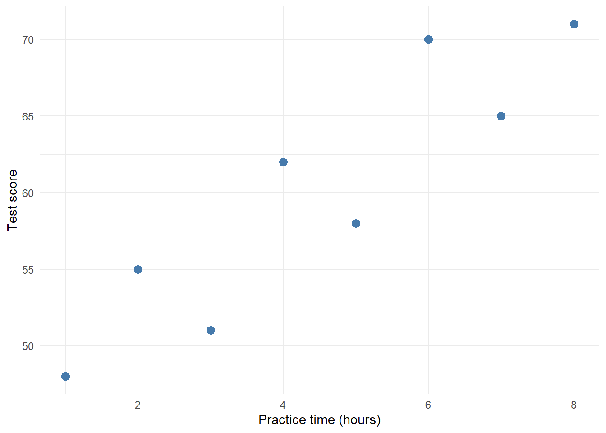

# Covariance and Correlation {#correlation}

## Two Values Per Person

So far, each person has given us one score. What happens when we measure two things about each person?

Imagine recording practice time and a test score. These are made-up data for eight people. Each row belongs to one person, so the two values in that row go together.


``` r
practice <- tibble(
  hours = c(1, 2, 3, 4, 5, 6, 7, 8),
  score = c(48, 55, 51, 62, 58, 70, 65, 71)
)

practice
```

<div class="kable-table">

| hours| score|
|-----:|-----:|
|     1|    48|
|     2|    55|
|     3|    51|
|     4|    62|
|     5|    58|
|     6|    70|
|     7|    65|
|     8|    71|

</div>

<div class="figure">

<p class="caption">(\#fig:paired-scatter)Each point represents one person. People with more practice hours tend to have higher scores.</p>
</div>


<div class='webex-solution'><button>Show the plot code</button>

``` r
ggplot(practice, aes(x = hours, y = score)) +
  geom_point(size = 3, colour = "#467AAC") +
  labs(x = "Practice time (hours)", y = "Test score") +
  theme_minimal()
```


</div>

There is an upward pattern, but the points do not lie on a straight line. We want a number that describes the direction and strength of this linear relationship.

## Files For This Chapter

Download the exercise file for this chapter and save it in the same folder as your `my_functions.R`:

- <a href="exercises/1f-correlation-exercises.Rmd" download>1f-correlation-exercises.Rmd</a>

## Load Your Toolbox

We will call the two columns `x` and `y`, then load your functions:


``` r
x <- pull(practice, hours)
y <- pull(practice, score)
```


``` r
library(tidyverse)
source("my_functions.R")
```


This chapter uses `my_mean()`, `my_var()`, and `my_sd()`. Check them first:


``` r
all.equal(my_mean(y), mean(y))
all.equal(my_var(y), var(y))
all.equal(my_sd(y), sd(y))
```

```
## [1] TRUE
## [1] TRUE
## [1] TRUE
```

## Two Distances From The Mean

For variance, we subtracted a mean from each value. We can do that for both variables, then multiply the two distances for each person. Use `mutate()` to add three columns to `practice`:

- `dx`: each person's practice time minus the mean practice time;
- `dy`: each person's score minus the mean score;
- `product`: `dx` multiplied by `dy`.


``` r
mean_x <- my_mean(x)
mean_y <- my_mean(y)

deviations <- practice %>%
  mutate(
    dx = ,
    dy = ,
    product =
  )

deviations
```


<div class='webex-solution'><button>Show a hint</button>

This is the same `mutate()` pattern as the squared distances in Chapter \@ref(equations). The practice times are in the `hours` column and the scores are in `score`. `product` can build on `dx` and `dy`, because `mutate()` can use a column it has only just made.

</div>


<div class='webex-solution'><button>Show one solution</button>


``` r
mean_x <- my_mean(x)
mean_y <- my_mean(y)

deviations <- practice %>%
  mutate(
    dx = hours - mean_x,
    dy = score - mean_y,
    product = dx * dy
  )

deviations
```

<div class="kable-table">

| hours| score|   dx|  dy| product|
|-----:|-----:|----:|---:|-------:|
|     1|    48| -3.5| -12|    42.0|
|     2|    55| -2.5|  -5|    12.5|
|     3|    51| -1.5|  -9|    13.5|
|     4|    62| -0.5|   2|    -1.0|
|     5|    58|  0.5|  -2|    -1.0|
|     6|    70|  1.5|  10|    15.0|
|     7|    65|  2.5|   5|    12.5|
|     8|    71|  3.5|  11|    38.5|

</div>

</div>


`dx` tells us how far someone's practice time is above or below the mean practice time. `dy` does the same for their score.

<div class="figure">

<p class="caption">(\#fig:paired-deviations)Zero on each axis means the corresponding variable's mean. Matching signs give positive products; opposite signs give negative products.</p>
</div>


<div class='webex-solution'><button>Show the plot code</button>

``` r
ggplot(deviations, aes(x = dx, y = dy)) +
  geom_hline(yintercept = 0, colour = "grey60") +
  geom_vline(xintercept = 0, colour = "grey60") +
  geom_point(size = 3, colour = "#467AAC") +
  labs(x = "Hours minus mean hours", y = "Score minus mean score") +
  theme_minimal()
```


</div>

Look at the `product` column. When we multiply the two distances for each person:

- Above both means: positive times positive gives a positive product.
- Below both means: negative times negative also gives a positive product.
- Above one mean and below the other: the product is negative.

If one person's `dx` is -2 and their `dy` is -3, their product is <input class='webex-solveme nospaces' size='1' data-answer='["6"]'/>.

## Covariance

Add those products and divide by the number of pairs minus one. That gives us the sample covariance:

$$
s_{xy} = \frac{\sum_{i=1}^{n}(x_i - \bar{x})(y_i - \bar{y})}{n-1}
$$

The subscript $i$ keeps each person's two values together. $n$ is the number of pairs. The summation sign tells us to add the products.

Now turn the equation into code. As with the squared distances in Chapter \@ref(equations), a function will only have the vectors `x` and `y`, so do this step with them. The distances are filled in for you; multiply them, then add up the products and divide by the number of pairs minus one:


``` r
dx <- x - my_mean(x)
dy <- y - my_mean(y)
products <-
sum() /
```


<div class='webex-solution'><button>Show a hint</button>

`products` is `dx * dy`. The top of the fraction is `sum(products)`, and $n$ is `length(x)`. Put brackets around `length(x) - 1`.

</div>


To two decimal places, the covariance is <input class='webex-solveme nospaces' size='5' data-answer='["18.86"]'/>.


<div class='webex-solution'><button>Show one solution</button>


``` r
dx <- x - my_mean(x)
dy <- y - my_mean(y)
products <- dx * dy
sum(products) / (length(x) - 1)
```

```
## [1] 18.85714
```

</div>


## Your Turn: Write `my_covariance()`

Put those steps into a function with two inputs, `x` and `y`:


``` r
my_covariance <- function(x, y) {
  dx <- 
  dy <- 
  products <- 
  output <- 
  return(output)
}

my_covariance(x, y)
```


<div class='webex-solution'><button>Show a hint</button>

`dx` and `dy` use `my_mean()`, exactly as in the chunk above. `products` multiplies them, and `output` divides the sum of the products by `length(x) - 1`.

</div>


<div class='webex-solution'><button>Show one solution</button>


``` r
my_covariance <- function(x, y) {
  dx <- x - my_mean(x)
  dy <- y - my_mean(y)
  products <- dx * dy
  output <- sum(products) / (length(x) - 1)
  return(output)
}

my_covariance(x, y)
```

```
## [1] 18.85714
```

</div>


## Check It Against `cov()`

`cov()` is R's sample covariance function.


``` r
c(mine = my_covariance(x, y), R = cov(x, y))
all.equal(my_covariance(x, y), cov(x, y))
```

```
##     mine        R 
## 18.85714 18.85714 
## [1] TRUE
```

And on a second, smaller pair of variables:


``` r
a <- c(2, 4, 9)
b <- c(3, 1, 8)

c(mine = my_covariance(a, b), R = cov(a, b))
all.equal(my_covariance(a, b), cov(a, b))
```

```
## mine    R 
##   11   11 
## [1] TRUE
```

Our version expects two numeric vectors of the same length, with at least two complete pairs and no missing values. Keep the rows paired: sorting one variable on its own would change who goes with whom.

Our covariance is positive. On balance, people above the mean on practice time are also above the mean on test score, and people below one mean are below the other.

What happens if we put the same variable into both inputs?


``` r
c(covariance = my_covariance(x, x), variance = my_var(x))
all.equal(my_covariance(x, x), my_var(x))
```

```
## covariance   variance 
##          6          6 
## [1] TRUE
```

We multiply each deviation by itself, so the products become squared deviations. Covariance of a variable with itself is its variance.

## Why Standardise?

Covariance depends on the units. Change hours to minutes and we multiply every practice-time deviation by 60.


``` r
c(hours = my_covariance(x, y), minutes = my_covariance(x * 60, y))
```

```
##      hours    minutes 
##   18.85714 1131.42857
```

The people and their scores have not changed, but the covariance is now 60 times larger. To describe strength without depending on these units, divide by the product of the two standard deviations:

$$
r = \frac{s_{xy}}{s_x s_y}
$$

This is Pearson's correlation coefficient, $r$.

## Your Turn: Write `my_correlation()`

The recipe is:

1. calculate the covariance with `my_covariance()`;
2. calculate the SD of each variable with `my_sd()`;
3. divide the covariance by the product of the two SDs.


``` r
my_correlation <- function(x, y) {
  covariance <- 
  sd_x <- 
  sd_y <- 
  output <- 
  return(output)
}

my_correlation(x, y)
```


<div class='webex-solution'><button>Show a hint</button>

For the last blank, put brackets around the bottom of the fraction: `covariance / (sd_x * sd_y)`.

</div>


<div class='webex-solution'><button>Show one solution</button>


``` r
my_correlation <- function(x, y) {
  covariance <- my_covariance(x, y)
  sd_x <- my_sd(x)
  sd_y <- my_sd(y)
  output <- covariance / (sd_x * sd_y)
  return(output)
}

my_correlation(x, y)
```

```
## [1] 0.9072647
```

</div>


## Check It Against `cor()`


``` r
c(mine = my_correlation(x, y), R = cor(x, y))
all.equal(my_correlation(x, y), cor(x, y))
```

```
##      mine         R 
## 0.9072647 0.9072647 
## [1] TRUE
```


``` r
c(mine = my_correlation(a, b), R = cor(a, b))
all.equal(my_correlation(a, b), cor(a, b))
```

```
##      mine         R 
## 0.8461538 0.8461538 
## [1] TRUE
```

Now change hours to minutes:


``` r
my_correlation(x * 60, y)
```

```
## [1] 0.9072647
```

Our correlation is 0.91. It describes a strong positive linear association in these eight observations. Multiplying hours by 60 also multiplies its SD by 60, so the change cancels when we divide.

Correlation ranges from -1 to 1. Both ends describe a perfect straight-line relationship; the sign gives its direction. A value near zero describes little linear association. There can still be a curved relationship, so always look at the scatterplot too. If either variable has zero SD, correlation is undefined because we would divide by zero.

Changing hours to minutes makes Pearson's correlation <select class='webex-select'><option value='blank'></option><option value='answer'>stay the same</option><option value=''>60 times larger</option><option value=''>negative</option></select>.

## Try It Interactively

Change the relationship slider and watch the paired deviations. Blue points have positive products and orange points have negative products. The table gives the numbers for each point.

<iframe src="apps/correlation/embed.html" width="100%" height="900" title="Explore covariance and correlation" style="border: 0;"></iframe>

1. Set the relationship to zero. Do the positive and negative products cancel?
2. Set a positive relationship, then double the scale of y. Predict which of covariance and correlation will change.
3. Choose a negative relationship. Explain why most products are now negative.


<div class='webex-solution'><button>Show explanations</button>

At zero, the products sum to zero in this constructed example. Doubling the scale of y doubles covariance and its SD, so correlation stays the same. A negative relationship mostly pairs above-mean values of one variable with below-mean values of the other.

The slider constructs data with a chosen sample correlation. It does not draw a new random sample each time. A random sample from a population with zero correlation will usually have a sample correlation a little above or below zero.

</div>


## Your Turn: Two Predictions

Use the practice data to check two predictions:

1. Adding 10 to every score leaves the correlation unchanged.
2. Reversing the sign of every score reverses the correlation's sign.


``` r
my_correlation(x, y + 10)
my_correlation(x, -y)
```

Explain each result using deviations from the mean.


<div class='webex-solution'><button>Show one solution</button>


``` r
c(plus_10 = my_correlation(x, y + 10), reversed = my_correlation(x, -y))
```

```
##    plus_10   reversed 
##  0.9072647 -0.9072647
```
Adding 10 increases every score and the mean by 10, leaving deviations unchanged. Multiplying by -1 reverses every score deviation. That reverses the products and covariance, while SD stays positive.

</div>


## A t-Value Again

Our sample correlation describes the data we have. We can also test a null hypothesis that the population Pearson correlation is zero.

For independent pairs drawn from a bivariate normal population, the following statistic follows a t-distribution under that null hypothesis:

$$
t = r\sqrt{\frac{n-2}{1-r^2}}, \qquad df = n-2
$$

Here $n$ is the number of pairs. Unlike our one-sample t-test, the degrees of freedom are $n-2$. This is also the residual degrees of freedom in a simple regression with an intercept and one slope.

## Your Turn: Write `my_correlation_t()`

The recipe is:

1. calculate the correlation with `my_correlation()`;
2. count the pairs;
3. multiply r by the square root of $(n - 2) / (1 - r^2)$.


``` r
my_correlation_t <- function(x, y) {
  r <- 
  n <- 
  output <- 
  return(output)
}

my_correlation_t(x, y)
```


<div class='webex-solution'><button>Show a hint</button>

`n` is `length(x)`. In R, $r^2$ is written `r^2`, so the last line is `output <- r * sqrt((n - 2) / (1 - r^2))`.

</div>


<div class='webex-solution'><button>Show one solution</button>


``` r
my_correlation_t <- function(x, y) {
  r <- my_correlation(x, y)
  n <- length(x)
  output <- r * sqrt((n - 2) / (1 - r^2))
  return(output)
}

my_correlation_t(x, y)
```

```
## [1] 5.284229
```

</div>


This calculation needs at least three complete pairs and a correlation strictly between -1 and 1. Our small teaching functions do not check these conditions for us.

## Check It Against `cor.test()`


``` r
correlation_result <- cor.test(x, y, method = "pearson")
correlation_result
```

```
## 
## 	Pearson's product-moment correlation
## 
## data:  x and y
## t = 5.2842, df = 6, p-value = 0.001858
## alternative hypothesis: true correlation is not equal to 0
## 95 percent confidence interval:
##  0.5617016 0.9832936
## sample estimates:
##       cor 
## 0.9072647
```

The `t` in this output should match your function. As with `t.test()` in Chapter \@ref(t-statistic), `$statistic` pulls it out and `unname()` drops its label:


``` r
c(mine = my_correlation_t(x, y), R = unname(correlation_result$statistic))
all.equal(my_correlation_t(x, y), unname(correlation_result$statistic))
```

```
##     mine        R 
## 5.284229 5.284229 
## [1] TRUE
```

The t-values match. For our data, t is 5.28 with 6 degrees of freedom.

## Is It Significant?

`cor.test()` also reports a p-value. Because a correlation can be turned into a t-value, the same tools that give a p-value for the one-sample t-test work for correlation too. If you want to test a correlation, see the bonus correlation section in Chapter \@ref(p-values).

Whatever the p-value says, a correlation does not tell us whether practice caused the higher scores. These made-up observations also cannot establish anything about real students.

## Try It On Real Data

Every patient in the `sleep` data from Chapter \@ref(standard-error) tried both drugs, so each patient gives us two values: their extra sleep on the first drug and on the second. The rows for the second drug are in the same patient order as the first, so position 1 in each vector is patient 1, position 2 is patient 2, and so on.

Do patients who gain more sleep on one drug also gain more on the other?


``` r
drug_1 <- sleep %>% filter(group == 1) %>% pull(extra)
drug_2 <- sleep %>% filter(group == 2) %>% pull(extra)
drug_result <- cor.test(drug_1, drug_2)

c(mine = my_correlation(drug_1, drug_2), R = cor(drug_1, drug_2))
all.equal(my_correlation(drug_1, drug_2), cor(drug_1, drug_2))
all.equal(my_correlation_t(drug_1, drug_2), unname(drug_result$statistic))
```

```
##      mine         R 
## 0.7951702 0.7951702 
## [1] TRUE
## [1] TRUE
```

The correlation is strongly positive: patients who slept a lot more on one drug tended to sleep a lot more on the other too, so some patients respond more strongly to both drugs than others do. This comes back in Chapter \@ref(two-sample-t), where it changes how we compare the two drugs.

## Add To Your Toolbox

<div class="summary-box">
Copy your finished `my_covariance()`, `my_correlation()`, and `my_correlation_t()` into your `my_functions.R` file, under the **Covariance and Correlation** heading, and save it.
</div>

The steps are the same as in Chapter \@ref(equations):

1. Open `my_functions.R` from the **Files** pane.
2. Copy each finished function from your exercise file, from its first line down to its closing `}`, and paste it under the **Covariance and Correlation** heading.
3. Save the file.


<div class='webex-solution'><button>Show what my_functions.R should look like now</button>


``` r
# My statistics functions
#
# Add each function you build to this file, under the heading of the
# chapter you built it in. Later chapters load it with
# source("my_functions.R"), so every function here can be reused.
#
# Keep only the functions in this file. Run and check them in your
# exercise files, not here.
#
# Some functions return a tibble, so load the tidyverse before using them.


# PART I: BUILDING TEST STATISTICS =========================================


# From Equations to Code ---------------------------------------------------
my_mean <- function(x) {
  total <- sum(x)
  n <- length(x)
  output <- total / n
  return(output)
}

my_var <- function(x) {
  n <- length(x)
  mean_x <- my_mean(x)
  squared_distances <- (x - mean_x)^2
  total_squared_distance <- sum(squared_distances)

  output <- total_squared_distance / (n - 1)
  return(output)
}


# Spread and Standard Error ------------------------------------------------
my_sd <- function(x) {
  output <- sqrt(my_var(x))
  return(output)
}

my_se <- function(x) {
  n <- length(x)
  sd_x <- my_sd(x)
  output <- sd_x / sqrt(n)
  return(output)
}

my_summary <- function(x) {
  output <- tibble(
    n = length(x),
    mean = my_mean(x),
    variance = my_var(x),
    sd = my_sd(x),
    se = my_se(x)
  )
  return(output)
}

my_z_score <- function(x) {
  mean_x <- my_mean(x)
  sd_x <- my_sd(x)
  output <- (x - mean_x) / sd_x
  return(output)
}


# The One-Sample t-Test ----------------------------------------------------
my_t_value <- function(x, comparison_value) {
  mean_x <- my_mean(x)
  se_x <- my_se(x)
  output <- (mean_x - comparison_value) / se_x
  return(output)
}

my_t_test <- function(x, comparison_value) {
  t <- my_t_value(x, comparison_value)
  df <- length(x) - 1
  output <- tibble(t = t, df = df)
  return(output)
}


# Covariance and Correlation -----------------------------------------------
my_covariance <- function(x, y) {
  dx <- x - my_mean(x)
  dy <- y - my_mean(y)
  products <- dx * dy
  output <- sum(products) / (length(x) - 1)
  return(output)
}

my_correlation <- function(x, y) {
  covariance <- my_covariance(x, y)
  sd_x <- my_sd(x)
  sd_y <- my_sd(y)
  output <- covariance / (sd_x * sd_y)
  return(output)
}

my_correlation_t <- function(x, y) {
  r <- my_correlation(x, y)
  n <- length(x)
  output <- r * sqrt((n - 2) / (1 - r^2))
  return(output)
}


# PART II: TESTING BY SIMULATION ===========================================


# Null Distributions -------------------------------------------------------
# my_null_t() and my_cutoffs() go here


# p-values -----------------------------------------------------------------
# my_sim_p_value() and my_p_value() go here
# (and my_null_correlation_t() if you did the correlation section)


# Effects and Power --------------------------------------------------------
# my_effect_t(), my_power() and my_cohens_d() go here
```

</div>


Then check that the saved file works on its own. This is the last chunk of the exercise file:


``` r
rm(list = ls())
source("my_functions.R")

x <- c(1, 2, 3, 4, 5, 6, 7, 8)
y <- c(48, 55, 51, 62, 58, 70, 65, 71)
result <- cor.test(x, y)

all.equal(my_covariance(x, y), cov(x, y))
all.equal(my_correlation(x, y), cor(x, y))
all.equal(my_correlation_t(x, y), unname(result$statistic))
```

You should see three `TRUE`s:

```text
[1] TRUE
[1] TRUE
[1] TRUE
```

## Link Back And Next Step

Variance used squared deviations from one mean. Covariance used paired deviations from two means. Dividing covariance by two SDs gave us correlation. Turning that correlation into a t-value brought us back to t, which means the p-value and power tools in Part II work for correlation as well.
