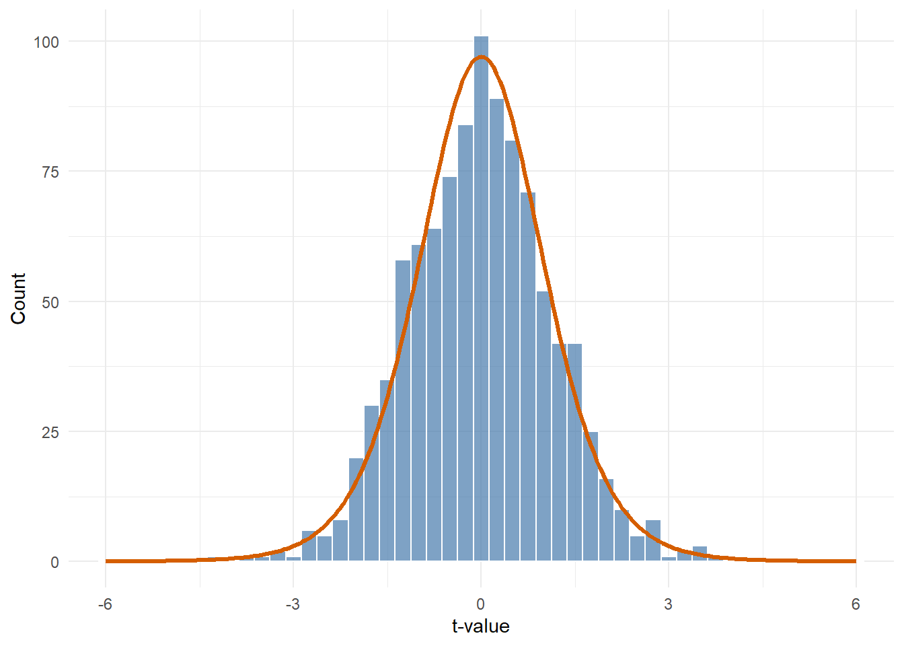

# p-values {#p-values}

In Chapter \@ref(null-distributions), we built a world where Steves are exactly average, drew 1000 groups of 10 from it, and turned each group into a t-value. We found the cutoffs that leave the most extreme 5% of those null t-values outside, and saw that rare groups turn up even when nothing is going on.

This chapter puts a number on "rare". If a t-value comes from the null world, the share of null t-values beyond a point is the probability of landing beyond it. Only 5% of the null t-values fall past the cutoffs, so a sample from the null world has a 5% probability of landing past them. The probability of a result at least as extreme as ours, if the null hypothesis is true, is called the **p-value**.

<div class="summary-box">
null t-values -> share at least as extreme as ours -> p-value
</div>

<div class="note">
**What you need for this chapter**

Chapter \@ref(null-distributions), and the chapters it needs. The last section of this chapter applies the same ideas to correlation: do it if you have done Chapter \@ref(correlation), and skip it if not.
</div>

## Files For This Chapter

Download the exercise file for this chapter and save it in the same folder as your `my_functions.R`:

- <a href="exercises/2b-p-values-exercises.Rmd" download>2b-p-values-exercises.Rmd</a>

## Load Your Toolbox

We will need the ten scores from Chapter \@ref(t-statistic) later on:


``` r
scores <- c(44, 47, 48, 49, 50, 50, 51, 52, 53, 56)
```


``` r
library(tidyverse)
source("my_functions.R")
```


This chapter leans on `my_t_value()` and on `my_null_t()` and `my_cutoffs()` from Chapter \@ref(null-distributions). Check them first:


``` r
all.equal(my_t_value(scores, 49), unname(t.test(scores, mu = 49)$statistic))

set.seed(1)
mine <- my_null_t(n = 10, pop_mean = 175, pop_sd = 7)
set.seed(1)
r_version <- unname(
  t.test(rnorm(n = 10, mean = 175, sd = 7), mu = 175)$statistic
)
all.equal(mine, r_version)

all.equal(my_cutoffs(20:1, alpha = 0.1), c(2, 19))
```

```
## [1] TRUE
## [1] TRUE
## [1] TRUE
```

Then recreate `null_ts` from Chapter \@ref(null-distributions): 1000 null t-values from groups of 10 Steves.


``` r
null_ts <- replicate(1000, my_null_t(n = 10, pop_mean = 175, pop_sd = 7))
```

## Alpha And Type I Errors

Every one of the 1000 t-values in `null_ts` came from a world where the null hypothesis is true: Steves really are exactly average. Say we used the cutoffs that mark the rarest 5%, `my_cutoffs(null_ts)`, to decide whether Steves are taller or shorter than average. We would wrongly call the result "far" for the 5% of samples that land past them. That kind of mistake is called a **Type I error**.

In the last chapter, alpha was the share of null values we marked as rare. Here is what that share means for a test: **alpha** is the probability of calling a result "far" when nothing is going on. With alpha = .05, 5% of samples from the null world land past the cutoffs, so a test that uses them makes a Type I error 5% of the time when the null hypothesis is true.

## Watch It Build

You built this null distribution yourself in Chapter \@ref(null-distributions). The widget below is its testing view: the same groups of 10 Steves and the same t-values, now with the cutoffs drawn in and a table counting how often samples land past them. It uses the exact cutoffs from the t distribution, which you will meet later in this chapter.

<iframe class="demyst-widget" src="apps/nhst/embed.html?mode=null&n=10&null=175&sd=7&unit=cm" width="100%" height="760" title="Null distribution of t interactive widget" style="border: 0;"></iframe>

<script>
// Let each widget set its own frame height, so it never needs a scroll bar.
window.addEventListener("message", function (event) {
  if (!event.data || !event.data.demystWidgetHeight) return;
  document.querySelectorAll("iframe.demyst-widget").forEach(function (frame) {
    if (frame.contentWindow === event.source) {
      frame.style.height = event.data.demystWidgetHeight + "px";
    }
  });
});
</script>

1. Click **+1** a few times, then **+1000**. Watch the share of null t-values past the cutoffs in the table: it settles near alpha, 5%. That is the Type I error rate.
2. Switch **Show t-values as** to **Dots**. The solid dots are the samples that would be wrongly called "far".
3. Change **Alpha** to .01 without adding samples. The cutoffs move outwards over the same t-values, and fewer of them are past the cutoffs.
4. Change the sample size and build it again. With very small samples, the tails get fatter, so the cutoffs move further out.

## Your Turn: Write `my_sim_p_value()`

Now we can answer the question from the start of Chapter \@ref(null-distributions): how far is far enough? A **p-value** is the proportion of the null distribution that is at least as far from zero as our t-value.

The recipe is:

1. for every null t-value, ask whether it is at least as far from zero as ours: `abs(null_ts) >= abs(t)`;
2. take the proportion of `TRUE`s.

The proportion of `TRUE`s is the mean of a set of `TRUE` and `FALSE` values, because R counts `TRUE` as 1 and `FALSE` as 0. So your own `my_mean()` does the job.


``` r
my_sim_p_value <- function(t, null_ts) {
  as_extreme <-
  output <-
  return(output)
}

my_sim_p_value(t = 0.95, null_ts = null_ts)
```


<div class='webex-solution'><button>Show a hint</button>

`as_extreme` is `abs(null_ts) >= abs(t)`, and `output` is `my_mean(as_extreme)`.

</div>


<div class='webex-solution'><button>Show one solution</button>


``` r
my_sim_p_value <- function(t, null_ts) {
  as_extreme <- abs(null_ts) >= abs(t)
  output <- my_mean(as_extreme)
  return(output)
}

my_sim_p_value(t = 0.95, null_ts = null_ts)
```

```
## [1] 0.403
```

</div>


`abs()` means both tails count: a t-value of -3 is just as far from zero as 3. This is a **two-sided** p-value.

## Check It: Close Enough

So far the null world has been Steves. For the p-values, we go back to the ten scores from Chapter \@ref(t-statistic) and their two comparison values, 49 and 46. The null t-values from the Steve world still work for them: under the null hypothesis, the distribution of t depends only on the sample size, not on the mean or SD, so any sample of 10 has the same null distribution.

Use `my_sim_p_value()` on the scores against the first comparison value, 49, and compare with the p-value from `t.test()`. A simulated p-value comes from 1000 random samples, so it wobbles a little around the exact one, just like a sample mean wobbles around the population mean. That means `all.equal()` would say `FALSE` even when your function is correct. For simulations, we check that the gap is small instead: `abs()` turns the gap into a positive distance, and `< 0.05` asks whether it is smaller than 0.05.


``` r
t_49 <- my_t_value(scores, comparison_value = 49)

c(
  simulated = my_sim_p_value(t_49, null_ts),
  R = t.test(scores, mu = 49)$p.value
)
abs(my_sim_p_value(t_49, null_ts) - t.test(scores, mu = 49)$p.value) < 0.05
```

```
## simulated         R 
## 0.4050000 0.3675581 
## [1] TRUE
```

Now the second comparison value, 46:


``` r
t_46 <- my_t_value(scores, comparison_value = 46)

c(
  simulated = my_sim_p_value(t_46, null_ts),
  R = t.test(scores, mu = 46)$p.value
)
abs(my_sim_p_value(t_46, null_ts) - t.test(scores, mu = 46)$p.value) < 0.05
```

```
##   simulated           R 
## 0.003000000 0.004251621 
## [1] TRUE
```

A `TRUE` each time means your simulated p-values are within 0.05 of the exact ones. You worked out a p-value by building the null distribution yourself.

## From Simulation To The t Distribution

If we simulated more and more samples, the histogram would get smoother and smoother. With endlessly many, it would become a smooth curve: the **t distribution**. Its exact shape depends only on the degrees of freedom.

<div class="figure">

<p class="caption">(\#fig:t-curve)The simulated null t-values with the exact t distribution for 9 degrees of freedom drawn over them.</p>
</div>


<div class='webex-solution'><button>Show the plot code</button>

``` r
curve_data <- tibble(t = seq(-6, 6, 0.05)) %>%
  mutate(count = 1000 * 0.25 * dt(t, df = 9))

ggplot(tibble(t = null_ts), aes(x = t)) +
  geom_histogram(binwidth = 0.25, colour = "white", fill = "#467AAC",
                 alpha = 0.7) +
  geom_line(data = curve_data, aes(x = t, y = count), colour = "#D55E00",
            linewidth = 1.1) +
  coord_cartesian(xlim = c(-6, 6)) +
  labs(x = "t-value", y = "Count") +
  theme_minimal()
```


</div>

Because R knows that curve exactly, it does not need to simulate. `pt()` gives the area of the t distribution *below* a value. For example, `pt(-2, df = 9)` is the proportion of t-values below -2. We will use `pt()` the way we used `sum()`: it is the one piece that would take far more than a chapter to build by hand.

## Your Turn: Write `my_p_value()`

The recipe is:

1. find the area in the lower tail, beyond the negative version of our t-value: `pt(-abs(t), df)`;
2. double it, because a two-sided test counts both tails.

`-abs(t)` is always negative, so the same code works whether our t-value is above or below zero.


``` r
my_p_value <- function(t, df) {
  lower_tail <-
  output <-
  return(output)
}

my_p_value(t = 0.95, df = 9)
```


<div class='webex-solution'><button>Show a hint</button>

`lower_tail` is `pt(-abs(t), df)`, and `output` is two times `lower_tail`.

</div>


<div class='webex-solution'><button>Show one solution</button>


``` r
my_p_value <- function(t, df) {
  lower_tail <- pt(-abs(t), df)
  output <- 2 * lower_tail
  return(output)
}

my_p_value(t = 0.95, df = 9)
```

```
## [1] 0.366924
```

</div>


## Check It Against `t.test()`

This time there is no simulation, so we expect an exact match:


``` r
c(mine = my_p_value(t_49, df = 9), R = t.test(scores, mu = 49)$p.value)
all.equal(my_p_value(t_49, df = 9), t.test(scores, mu = 49)$p.value)

all.equal(my_p_value(t_46, df = 9), t.test(scores, mu = 46)$p.value)
```

```
##      mine         R 
## 0.3675581 0.3675581 
## [1] TRUE
## [1] TRUE
```

## Back To Our Two Comparison Values


| Comparison value | t | Simulated p | Exact p | Past the cutoff at alpha .05? |
|---|---|---|---|---|
| 49 | 0.95 | 0.405 | 0.368 | No |
| 46 | 3.79 | 0.003 | 0.004 | Yes |

Against 49, a t-value as far from zero as ours turns up in about 37% of samples even when the null is true. That is not unusual, so we would not reject the null hypothesis. That does not show that the population mean is exactly 49. It only means our data are quite compatible with it.

Against 46, a t-value that far out turns up in less than 1% of samples when the null is true. That is unusual enough to pass the cutoff, so we would reject the null hypothesis that the population mean is 46.

Two warnings:

- the p-value is **not** the probability that the null hypothesis is true. It is the probability of a result at least this extreme, *if* the null hypothesis were true;
- the exact p-value from `t.test()` assumes independent observations from a normal population. Our simulation made the same assumption when it used `rnorm()`.

Which statement describes a p-value of .004? <select class='webex-select'><option value='blank'></option><option value=''>There is a 0.4% chance that the null hypothesis is true</option><option value='answer'>If the null hypothesis were true, a t-value at least this extreme would turn up in about 0.4% of samples</option><option value=''>There is a 99.6% chance that there is a real difference</option></select>

## The t-Value As An Anchor

Everything in this chapter worked on a t-value. Many statistics can be turned into a t-value, so the same tools work for them too. If you have done Chapter \@ref(correlation), the bonus section at the end of this chapter turns a correlation into a t-value and uses these same tools on it.

## Try It On Real Data

Back to the `sleep` data. In Chapter \@ref(t-statistic), the first drug's mean extra sleep was about 1.3 standard errors above 0. There are 10 patients, so we can reuse `null_ts`, the null distribution we built from groups of 10:


``` r
drug_1 <- sleep %>% filter(group == 1) %>% pull(extra)
drug_t <- my_t_value(drug_1, comparison_value = 0)

c(
  simulated = my_sim_p_value(drug_t, null_ts),
  exact = my_p_value(drug_t, df = 9),
  R = t.test(drug_1, mu = 0)$p.value
)

abs(my_sim_p_value(drug_t, null_ts) - t.test(drug_1, mu = 0)$p.value) < 0.05
all.equal(my_p_value(drug_t, df = 9), t.test(drug_1, mu = 0)$p.value)
```

```
## simulated     exact         R 
## 0.2400000 0.2175978 0.2175978 
## [1] TRUE
## [1] TRUE
```

`null_ts` came from Steves' heights, with a mean of 175 cm and an SD of 7 cm, nothing like hours of sleep. This is fine, because under the null hypothesis, the distribution of t depends only on the sample size, not on the mean or SD of the values.

A p-value of about 0.22 is not past the cutoff at alpha .05, so we would not reject the null hypothesis that the first drug adds no sleep on average. That does not show the drug has no effect: with only 10 patients, a modest effect could easily be missed. Chapter \@ref(effects-power) shows how often a real effect gets missed.

## Bonus: Correlation

This section needs Chapter \@ref(correlation). There we turned a correlation into a t-value, which means everything in this chapter works for it too. The question is the same: if there were no relationship at all, how unusual would a t-value like ours be?

We will use the eight practice-time and test-score pairs from Chapter \@ref(correlation):


``` r
x <- c(1, 2, 3, 4, 5, 6, 7, 8)
y <- c(48, 55, 51, 62, 58, 70, 65, 71)
correlation_result <- cor.test(x, y, method = "pearson")
```

To build the null distribution, we need samples where the null hypothesis is true. We keep the practice hours as they are, and pair them with test scores drawn completely at random, so there is no relationship between the two. Correlation does not depend on the mean or SD of the scores, so `rnorm()` with its defaults (a mean of 0 and an SD of 1) is fine.

### Your Turn: Write `my_null_correlation_t()`

This works just like `my_null_t()`:

1. draw random y values, one for each x value: `rnorm(length(x))`;
2. calculate the correlation t-value with `my_correlation_t()`.


``` r
my_null_correlation_t <- function(x) {
  null_y <-
  output <-
  return(output)
}

my_null_correlation_t(x)
```


<div class='webex-solution'><button>Show a hint</button>

`null_y` is `rnorm(length(x))`, and `output` is `my_correlation_t(x, null_y)`.

</div>


<div class='webex-solution'><button>Show one solution</button>


``` r
my_null_correlation_t <- function(x) {
  null_y <- rnorm(length(x))
  output <- my_correlation_t(x, null_y)
  return(output)
}

my_null_correlation_t(x)
```

```
## [1] -0.7486412
```

</div>


### Check It Against R

As before, `set.seed()` lets us repeat the same random numbers and compare with `cor.test()`:


``` r
set.seed(1)
mine <- my_null_correlation_t(x)

set.seed(1)
r_version <- unname(cor.test(x, rnorm(length(x)))$statistic)

c(mine = mine, R = r_version)
all.equal(mine, r_version)
```

```
##      mine         R 
## 0.8759611 0.8759611 
## [1] TRUE
```

### The Null Distribution For Correlation

Now repeat it 1000 times and use your tools from this chapter and the last on the result, without changing them:


``` r
null_correlation_ts <- replicate(1000, my_null_correlation_t(x))

tibble(
  cutoff = c("lower", "upper"),
  mine = my_cutoffs(null_correlation_ts),
  quantile = unname(quantile(null_correlation_ts, c(0.025, 0.975))),
  theory = qt(c(0.025, 0.975), df = length(x) - 2)
)
```

<div class="kable-table">

|cutoff |      mine|  quantile|    theory|
|:------|---------:|---------:|---------:|
|lower  | -2.589077| -2.589179| -2.446912|
|upper  |  2.568422|  2.568610|  2.446912|

</div>

`quantile()` is R's own way of finding the value that a given proportion of the data falls below. `mine` and `quantile` agree closely without being identical, because `quantile()` blends two neighbouring sorted values and `my_cutoffs()` picks one. Both sit near the `theory` column, with a little more wobble. Check the gap:


``` r
abs(
  my_cutoffs(null_correlation_ts) - qt(c(0.025, 0.975), df = length(x) - 2)
) < 0.6
```

```
## [1] TRUE TRUE
```

The cutoffs match a t distribution with $n - 2 = 6$ degrees of freedom, as the formula said they would. We allow a gap of up to 0.6 here. With only 8 pairs, the tails of the distribution are wide, so simulated cutoffs wobble a lot from one simulation to the next.

Now the p-values. First by simulation, then exactly with `my_p_value()`:


``` r
our_t <- my_correlation_t(x, y)

c(
  simulated = my_sim_p_value(our_t, null_correlation_ts),
  exact = my_p_value(our_t, df = length(x) - 2),
  R = correlation_result$p.value
)

abs(
  my_sim_p_value(our_t, null_correlation_ts) - correlation_result$p.value
) < 0.05
all.equal(my_p_value(our_t, df = length(x) - 2), correlation_result$p.value)
```

```
##   simulated       exact           R 
## 0.005000000 0.001857673 0.001857673 
## [1] TRUE
## [1] TRUE
```

Your `my_p_value()` was written for a one-sample t-test, but it reproduces the p-value from `cor.test()` exactly. That works because we turned r into a t-value first. Any statistic that can be turned into a t-value with the right degrees of freedom can get its p-value from the same tools.


For our data, a t-value as far from zero as 5.28 would turn up in about 0.19% of samples if there were no relationship. That is unusual enough to pass the cutoff at alpha .05, so we would reject the null hypothesis of no linear relationship in the population.

A small p-value does not tell us whether practice caused the higher scores. These made-up observations also cannot establish anything about real students.

### On Real Data

The extra sleep on the two drugs from Chapter \@ref(correlation):


``` r
drug_1 <- sleep %>% filter(group == 1) %>% pull(extra)
drug_2 <- sleep %>% filter(group == 2) %>% pull(extra)
drug_result <- cor.test(drug_1, drug_2)

all.equal(
  my_p_value(my_correlation_t(drug_1, drug_2), df = length(drug_1) - 2),
  drug_result$p.value
)
```

```
## [1] TRUE
```

## Add To Your Toolbox

<div class="summary-box">
Copy your finished `my_sim_p_value()` and `my_p_value()` into your `my_functions.R` file, under the **p-values** heading, and save it. If you did the correlation section, add `my_null_correlation_t()` too.
</div>

The steps are the same as in Chapter \@ref(equations):

1. Open `my_functions.R` from the **Files** pane.
2. Copy each finished function from your exercise file, from its first line down to its closing `}`, and paste it under the **p-values** heading.
3. Save the file.


<div class='webex-solution'><button>Show what this section of my_functions.R should look like</button>


``` r
# p-values -----------------------------------------------------------------
my_sim_p_value <- function(t, null_ts) {
  as_extreme <- abs(null_ts) >= abs(t)
  output <- my_mean(as_extreme)
  return(output)
}

my_p_value <- function(t, df) {
  lower_tail <- pt(-abs(t), df)
  output <- 2 * lower_tail
  return(output)
}

# Bonus: correlation
my_null_correlation_t <- function(x) {
  null_y <- rnorm(length(x))
  output <- my_correlation_t(x, null_y)
  return(output)
}
```
The rest of your file depends on which chapters you have done so far.

</div>


Then check that the saved file works on its own. This is the last chunk of the exercise file:


``` r
rm(list = ls())
source("my_functions.R")

all.equal(my_sim_p_value(2, c(-3, -1, 0, 1, 2.5)), 0.4)

scores <- c(44, 47, 48, 49, 50, 50, 51, 52, 53, 56)
all.equal(
  my_p_value(my_t_value(scores, 46), df = 9),
  t.test(scores, mu = 46)$p.value
)
```

You should see two `TRUE`s:

```text
[1] TRUE
[1] TRUE
```

## Where This Goes Next

<div class="summary-box">
null t-values -> cutoffs -> p-value
</div>

So far, every group of Steves came from a world where the null hypothesis was true. In the next chapter, we add a second world, where Steves really are taller, and use the same cutoffs to ask how often a study of 10 Steves spots the difference. That proportion is called **power**.
