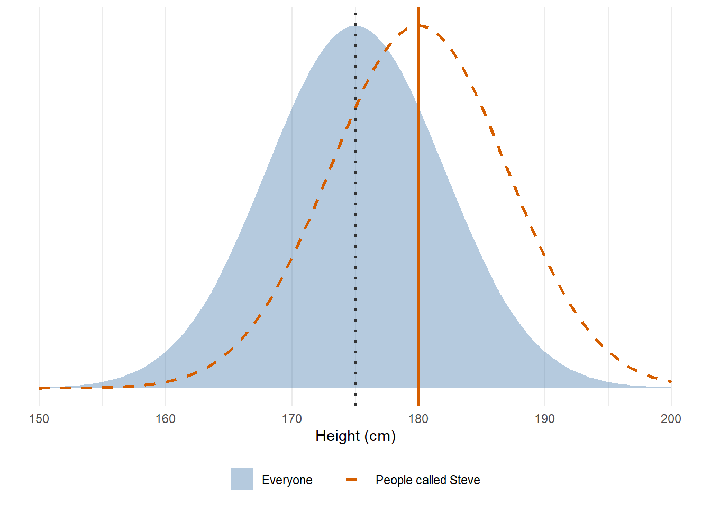
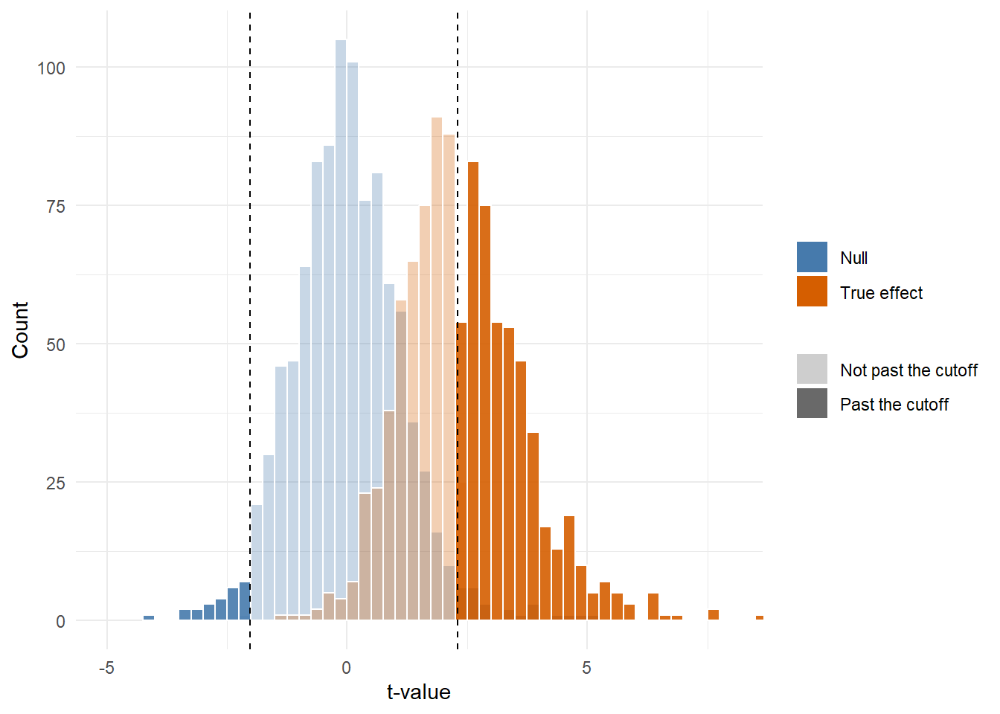
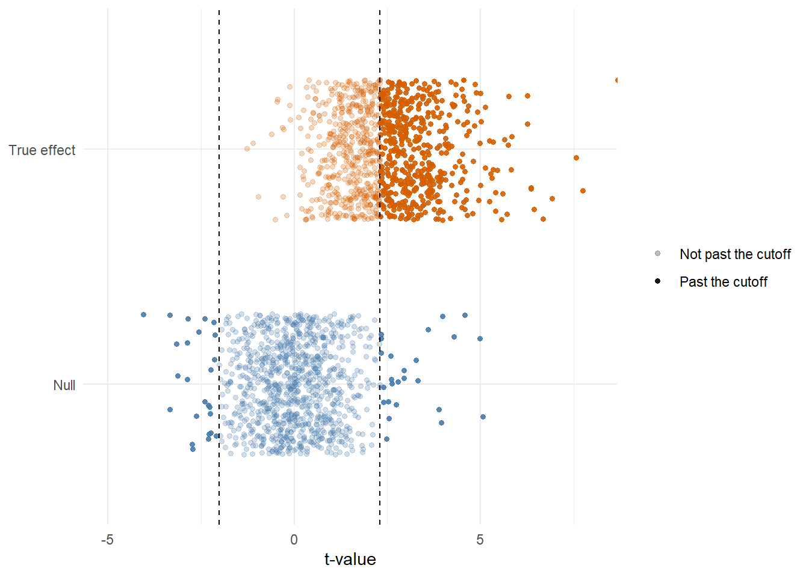

# Effects and Power {#effects-power}

## Two Worlds

In Chapters \@ref(null-distributions) and \@ref(p-values), every group of Steves came from a world where Steves are exactly average. 5% of the null t-values land past the cutoffs, and that 5% is alpha, the Type I error rate.

Now we add a second world, where Steves really are taller. The question flips around: if the difference is real, how often does a group's t-value land past the same cutoffs? That proportion is called **power**.

<div class="summary-box">
null world -> cutoffs -> how often do groups from the effect world pass those same cutoffs?
</div>

<div class="note">
**What you need for this chapter**

Chapter \@ref(t-statistic) (the one-sample t-test), Chapter \@ref(null-distributions) (null distributions and cutoffs) and Chapter \@ref(p-values) (p-values).
</div>

## Files For This Chapter

Download the exercise file for this chapter and save it in the same folder as your `my_functions.R`:

- <a href="exercises/2c-effects-power-exercises.Rmd" download>2c-effects-power-exercises.Rmd</a>

## Load Your Toolbox


``` r
scores <- c(44, 47, 48, 49, 50, 50, 51, 52, 53, 56)
```


``` r
library(tidyverse)
source("my_functions.R")
```


This chapter builds on your functions from Chapters \@ref(t-statistic), \@ref(null-distributions) and \@ref(p-values). Check a few of them first:


``` r
all.equal(my_t_value(scores, 46), unname(t.test(scores, mu = 46)$statistic))
all.equal(my_p_value(my_t_value(scores, 46), df = 9), t.test(scores, mu = 46)$p.value)
all.equal(my_cutoffs(20:1, alpha = 0.1), c(2, 19))
```

```
## [1] TRUE
## [1] TRUE
## [1] TRUE
```

We will also use the `pwr` package, which you may have met before. It has ready-made power functions, so we can check our simulations against it.


``` r
library(pwr)
```

## A World With An Effect

In this world, people called Steve really are taller. Everyone's heights still have a mean of 175 cm and an SD of 7 cm, but Steves' heights have a mean of 180 cm, with the same SD. The heights are made up, but realistic for adults.

<div class="figure">

<p class="caption">(\#fig:steve-effect-world)In the effect world, Steves' heights (dashed) sit 5 cm to the right of everyone's (filled). The heights are made up but realistic.</p>
</div>


<div class='webex-solution'><button>Show the plot code</button>

``` r
heights <- tibble(height = seq(150, 200, by = 0.5)) %>%
  mutate(
    everyone = dnorm(height, mean = 175, sd = 7),
    steves = dnorm(height, mean = 180, sd = 7)
  )

ggplot(heights, aes(x = height)) +
  geom_area(aes(y = everyone, fill = "Everyone"), alpha = 0.4) +
  geom_line(aes(y = steves, colour = "People called Steve"),
            linetype = "dashed", linewidth = 1) +
  geom_vline(xintercept = 175, linetype = "dotted", linewidth = 0.9,
             colour = "grey20") +
  geom_vline(xintercept = 180, linewidth = 0.9, colour = "#D55E00") +
  scale_fill_manual(NULL, values = c("Everyone" = "#467AAC")) +
  scale_colour_manual(NULL, values = c("People called Steve" = "#D55E00")) +
  guides(fill = guide_legend(order = 1), colour = guide_legend(order = 2)) +
  scale_y_continuous(NULL, breaks = NULL) +
  labs(x = "Height (cm)") +
  theme_minimal() +
  theme(legend.position = "bottom")
```


</div>

We still compare each group of 10 Steves with 175, the average. The null hypothesis says Steves are average; in this world it is false.

How big is the difference? A common way to say is **Cohen's d**: the difference between the true mean and the comparison value, measured in standard deviations.

$$
d = \frac{\text{true mean} - \text{comparison value}}{\text{SD}}
$$

For the Steves, that is (180 - 175) / 7 = 0.71. A d of 0.2 is usually called small, 0.5 medium and 0.8 large, so this is a medium-to-large difference: about 0.7 of an SD. You will write a function for d later in the chapter.

## Build Both Distributions

Now take 1000 groups of 10 from each world. The null t-values and the cutoffs come from the null world, exactly as in Chapter \@ref(null-distributions). For the effect world, each group of 10 Steves comes from a population with a mean of 180, and its t-value is still worked out against 175. You will wrap that second line in your own function, `my_effect_t()`, later in the chapter.


``` r
null_ts <- replicate(1000, my_null_t(n = 10, pop_mean = 175, pop_sd = 7))
effect_ts <- replicate(
  1000, my_t_value(rnorm(n = 10, mean = 180, sd = 7), comparison_value = 175)
)

cutoffs <- my_cutoffs(null_ts)
cutoffs
```

```
## [1] -2.012152  2.300096
```


<div class="figure">

<p class="caption">(\#fig:both-histograms)1000 t-values from each world. The dashed lines are the cutoffs from the null distribution. Bars past the cutoffs are solid.</p>
</div>


<div class='webex-solution'><button>Show the plot code</button>

``` r
ggplot(worlds, aes(x = t, fill = world, alpha = past)) +
  geom_histogram(binwidth = 0.25, boundary = 0, position = "identity",
                 colour = "white") +
  geom_vline(xintercept = cutoffs, linetype = "dashed") +
  scale_fill_manual(values = c("Null" = "#467AAC", "True effect" = "#D55E00")) +
  scale_alpha_manual(values = c("Not past the cutoff" = 0.3,
                                "Past the cutoff" = 0.9)) +
  coord_cartesian(xlim = c(-5, 8)) +
  labs(x = "t-value", y = "Count", fill = NULL, alpha = NULL) +
  theme_minimal()
```


</div>

The histograms show where the two worlds overlap. About half of the orange t-values are past the upper cutoff, but the rest sit in the same place as the blue ones. Those groups of Steves came from a world where Steves really are taller, but their t-values look like they could have come from the null world.

## Counting Dots

The same t-values drawn as dots, one per group, make it easier to see that we can simply *count* them:

<div class="figure">

<p class="caption">(\#fig:both-dots)The same 2000 t-values as dots. Solid dots are past the cutoffs.</p>
</div>


<div class='webex-solution'><button>Show the plot code</button>

``` r
ggplot(worlds, aes(x = t, y = world, colour = world, alpha = past)) +
  geom_jitter(height = 0.3, width = 0, size = 1.2) +
  geom_vline(xintercept = cutoffs, linetype = "dashed") +
  scale_colour_manual(values = c("Null" = "#467AAC", "True effect" = "#D55E00"),
                      guide = "none") +
  scale_alpha_manual(values = c("Not past the cutoff" = 0.25,
                                "Past the cutoff" = 0.9)) +
  coord_cartesian(xlim = c(-5, 8)) +
  labs(x = "t-value", y = NULL, alpha = NULL) +
  theme_minimal()
```


</div>

Count the solid and faded dots in each world:


``` r
null_past <- null_ts < cutoffs[1] | null_ts > cutoffs[2]
effect_past <- effect_ts < cutoffs[1] | effect_ts > cutoffs[2]

tibble(
  world = c("null", "effect"),
  past = c(sum(null_past), sum(effect_past)),
  not_past = c(sum(!null_past), sum(!effect_past))
)
```

<div class="kable-table">

|world  | past| not_past|
|:------|----:|--------:|
|null   |   50|      950|
|effect |  492|      508|

</div>

`|` means "or", so `null_past` is `TRUE` for every t-value below the lower cutoff *or* above the upper one. `!` means "not", so `sum(!null_past)` counts the ones that are not past the cutoffs.


Those four numbers fill in a table of every possible outcome:

| | Not past the cutoff | Past the cutoff |
|---|---|---|
| **Null world** (Steves are average) | 950: correct, no effect found | 50: **Type I error** (false positive) |
| **Effect world** (Steves are taller) | 508: **Type II error** (false negative) | 492: correct, effect found |

- The proportion of null groups past the cutoff is **alpha**, the Type I error rate. We chose it to be 5%.
- The proportion of effect groups *not* past the cutoff is **beta**, the Type II error rate.
- The proportion of effect groups past the cutoff is **power**. Power is $1 - \beta$.

Here, only 492 of the 1000 groups from the effect world passed the cutoffs. Steves really are 5 cm taller in this world, yet a study of 10 Steves found that difference only about 49% of the time, and missed it the rest of the time. A real 5 cm difference is missed about half the time.

Alpha and beta play off each other through the cutoffs. Move the cutoffs outwards (a smaller alpha) and fewer null groups pass them, but fewer effect groups pass them too, so beta goes up and power goes down.

## Watch It Build

The widget now has both worlds. Blue groups come from the null world, where Steves are average, and orange groups come from the effect world, where they are taller.

<iframe class="demyst-widget" src="apps/nhst/embed.html?n=10&null=175&sd=7&mean=180&unit=cm" width="100%" height="960" title="Null and true-effect t distributions interactive widget" style="border: 0;"></iframe>

<script>
// Let each widget set its own frame height, so it never needs a scroll bar.
window.addEventListener("message", function (event) {
  if (!event.data || !event.data.demystWidgetHeight) return;
  document.querySelectorAll("iframe.demyst-widget").forEach(function (frame) {
    if (frame.contentWindow === event.source) {
      frame.style.height = event.data.demystWidgetHeight + "px";
    }
  });
});
</script>

1. Click **Null +1000** to build the null distribution. Then click **True +1** a few times and watch where each group of taller Steves lands.
2. Click **True +1000**. Where do the two histograms overlap? Bars past the cutoffs are solid.
3. Switch **Show t-values as** to **Dots**. Every group is now a dot, and the table below counts the solid and faded dots in each world: the same four cells as the table above.
4. Change the **True mean** to make Steves taller or shorter (the d next to it updates). Each change clears the plot, so build both worlds again. What happens to the share of orange dots past the cutoffs?
5. Change the **Sample size** and build both worlds again. What happens to the orange t-values when the groups are bigger?
6. Change **Alpha** to .01 without rebuilding. The cutoffs move outwards over the same t-values: fewer null dots pass them, but fewer orange dots do too.

## Your Turn: Write `my_effect_t()`

Now build the pieces yourself. `my_effect_t()` is `my_null_t()` from Chapter \@ref(null-distributions) with one change: the population mean and the comparison value are separate inputs, so they can be different. It does what the `effect_ts` line in Build Both Distributions did.


``` r
my_effect_t <- function(n, pop_mean, pop_sd, comparison_value) {
  sample_values <-
  output <-
  return(output)
}

my_effect_t(n = 10, pop_mean = 180, pop_sd = 7, comparison_value = 175)
```


<div class='webex-solution'><button>Show a hint</button>

`sample_values` uses `rnorm(n = n, mean = pop_mean, sd = pop_sd)`, and `output` uses `my_t_value(sample_values, comparison_value)`.

</div>


<div class='webex-solution'><button>Show one solution</button>


``` r
my_effect_t <- function(n, pop_mean, pop_sd, comparison_value) {
  sample_values <- rnorm(n = n, mean = pop_mean, sd = pop_sd)
  output <- my_t_value(sample_values, comparison_value)
  return(output)
}

my_effect_t(n = 10, pop_mean = 180, pop_sd = 7, comparison_value = 175)
```

```
## [1] 0.7851572
```

</div>


## Check It Against R


``` r
set.seed(1)
mine <- my_effect_t(n = 10, pop_mean = 180, pop_sd = 7, comparison_value = 175)

set.seed(1)
r_version <- unname(
  t.test(rnorm(n = 10, mean = 180, sd = 7), mu = 175)$statistic
)

c(mine = mine, R = r_version)
all.equal(mine, r_version)
```

```
##     mine        R 
## 3.429259 3.429259 
## [1] TRUE
```

If you set `pop_mean` equal to `comparison_value`, `my_effect_t()` does exactly what `my_null_t()` does. The null world is just the effect world with an effect of zero.

## Your Turn: Write `my_power()`

Power is the proportion of t-values past the cutoffs. That is one comparison and one mean:


``` r
my_power <- function(ts, cutoffs) {
  past <-
  output <-
  return(output)
}

my_power(effect_ts, cutoffs)
```


<div class='webex-solution'><button>Show a hint</button>

`past` is `ts < cutoffs[1] | ts > cutoffs[2]`, and `output` is `my_mean(past)`.

</div>


<div class='webex-solution'><button>Show one solution</button>


``` r
my_power <- function(ts, cutoffs) {
  past <- ts < cutoffs[1] | ts > cutoffs[2]
  output <- my_mean(past)
  return(output)
}

my_power(effect_ts, cutoffs)
```

```
## [1] 0.492
```

</div>


Try it on the null t-values too:


``` r
my_power(null_ts, cutoffs)
```

```
## [1] 0.05
```

The same function gives 0.05. "Power" in a world with no effect is just the Type I error rate.

## Check It: Close Enough

R's `power.t.test()` and the `pwr` package's `pwr.t.test()` both calculate power exactly from the t distribution. `power.t.test()` takes the raw difference (`delta`, here 5 cm) and the SD; `pwr.t.test()` takes Cohen's d.


``` r
c(
  simulated = my_power(effect_ts, cutoffs),
  power.t.test = power.t.test(n = 10, delta = 5, sd = 7,
                              type = "one.sample")$power,
  pwr.t.test = pwr.t.test(n = 10, d = 5 / 7, type = "one.sample")$power
)

abs(
  my_power(effect_ts, cutoffs) -
    pwr.t.test(n = 10, d = 5 / 7, type = "one.sample")$power
) < 0.12
```

```
##    simulated power.t.test   pwr.t.test 
##    0.4920000    0.5223237    0.5223539 
## [1] TRUE
```

Your simulated power is within 0.12 of the exact answer. We allow a bigger gap than for the p-values in Chapter \@ref(p-values) because two things wobble here: the cutoffs come from one simulation and the effect t-values from another.


With groups of 10 and a real difference of 5 cm (d = 0.71), the exact power is 0.52. A study like this finds the difference about 52% of the time and misses it about 48% of the time: roughly a coin toss, even though Steves really are taller.

## Your Turn: Write `my_cohens_d()`

In A World With An Effect, d used the true mean and the true SD of the population. With real data we only have a sample, so we use the sample mean and the sample SD instead:

$$
d = \frac{\bar{x} - \mu_0}{s}
$$

This looks a lot like the t-statistic, but the bottom of the fraction is the standard deviation, not the standard error. The t-value asks how far the mean is from the comparison value compared with the *noise in the mean*. Cohen's d asks how far it is compared with the *spread of individual values*.


``` r
my_cohens_d <- function(x, comparison_value) {
  mean_x <-
  sd_x <-
  output <-
  return(output)
}

my_cohens_d(scores, comparison_value = 46)
```


<div class='webex-solution'><button>Show a hint</button>

`mean_x` uses `my_mean(x)`, `sd_x` uses `my_sd(x)`, and `output` is `(mean_x - comparison_value) / sd_x`.

</div>


<div class='webex-solution'><button>Show one solution</button>


``` r
my_cohens_d <- function(x, comparison_value) {
  mean_x <- my_mean(x)
  sd_x <- my_sd(x)
  output <- (mean_x - comparison_value) / sd_x
  return(output)
}

my_cohens_d(scores, comparison_value = 46)
```

```
## [1] 1.2
```

</div>


## Check It: d And t

Base R does not have a Cohen's d function, but there is an exact link we can check. The standard error is the SD divided by $\sqrt{n}$, so the t-value is just d multiplied by $\sqrt{n}$:

$$
t = d \times \sqrt{n}
$$

Write the right-hand side in code for our scores against 46, then compare it with `my_t_value()`:


``` r
d_times_root_n <-
c(d_times_root_n = d_times_root_n, t = my_t_value(scores, 46))
all.equal(d_times_root_n, my_t_value(scores, 46))
```


<div class='webex-solution'><button>Show a hint</button>

Use `my_cohens_d(scores, 46)` for d, and `sqrt()` with `length(scores)` for $\sqrt{n}$.

</div>


<div class='webex-solution'><button>Show one solution</button>


``` r
d_times_root_n <- my_cohens_d(scores, 46) * sqrt(length(scores))
c(d_times_root_n = d_times_root_n, t = my_t_value(scores, 46))
all.equal(d_times_root_n, my_t_value(scores, 46))
```

```
## d_times_root_n              t 
##       3.794733       3.794733 
## [1] TRUE
```

</div>


For the same effect size, a bigger sample gives a bigger t-value, so it is more likely to pass the cutoff. That is why the groups of 10 Steves so often missed a real 5 cm difference: with d = 0.71 and n = 10, the effect world's t-values centre around 2.3, right next to the upper cutoff.

Our ten scores are 1.2 SDs above 46. By the usual rules of thumb, a d of 0.2 is small, 0.5 is medium, and 0.8 is large.

## Add To Your Toolbox

<div class="summary-box">
Copy your finished `my_effect_t()`, `my_power()` and `my_cohens_d()` into your `my_functions.R` file, under the **Effects and Power** heading, and save it.
</div>

The steps are the same as in Chapter \@ref(equations):

1. Open `my_functions.R` from the **Files** pane.
2. Copy each finished function from your exercise file, from its first line down to its closing `}`, and paste it under the **Effects and Power** heading.
3. Save the file.


<div class='webex-solution'><button>Show what this section of my_functions.R should look like</button>


``` r
# Effects and Power --------------------------------------------------------
my_effect_t <- function(n, pop_mean, pop_sd, comparison_value) {
  sample_values <- rnorm(n = n, mean = pop_mean, sd = pop_sd)
  output <- my_t_value(sample_values, comparison_value)
  return(output)
}

my_power <- function(ts, cutoffs) {
  past <- ts < cutoffs[1] | ts > cutoffs[2]
  output <- my_mean(past)
  return(output)
}

my_cohens_d <- function(x, comparison_value) {
  mean_x <- my_mean(x)
  sd_x <- my_sd(x)
  output <- (mean_x - comparison_value) / sd_x
  return(output)
}
```
The rest of your file depends on which chapters you have done so far.

</div>


Then check that the saved file works on its own. This is the last chunk of the exercise file:


``` r
rm(list = ls())
source("my_functions.R")

set.seed(1)
mine <- my_effect_t(n = 10, pop_mean = 180, pop_sd = 7, comparison_value = 175)
set.seed(1)
r_version <- unname(
  t.test(rnorm(n = 10, mean = 180, sd = 7), mu = 175)$statistic
)
all.equal(mine, r_version)

all.equal(my_power(c(-3, -1, 0, 1, 2.5), c(-2, 2)), 0.4)

scores <- c(44, 47, 48, 49, 50, 50, 51, 52, 53, 56)
all.equal(
  my_cohens_d(scores, 46) * sqrt(length(scores)),
  my_t_value(scores, 46)
)
```

You should see three `TRUE`s:

```text
[1] TRUE
[1] TRUE
[1] TRUE
```

## Where This Goes Next

<div class="summary-box">
null t-values -> cutoffs -> effect t-values -> count what passes -> power
</div>

Everything in Part II has worked on t-values. Any statistic you can turn into a t-value, like the correlation in Chapter \@ref(correlation), can go through the same steps. If you came here early, Part I is waiting with more test statistics to build.
